# 飞行器 ROS2 激光 SLAM 方案

> **原创**：赵立凯          **作者**：闫腾岳      


------

**配套文件提取链接（GitHub）：**[The-SLAM-of-Raspberrypi5b-and-ROS2-and-N10radar](https://github.com/Flightsquadyeah/The-SLAM-of-Raspberrypi5b-and-ROS2-and-N10radar)

**配套文件也会以压缩包的方式传至QQ群内**

**本文涉及功能包皆在`Pakage`文件夹**

**本文涉及教学文档皆在`Instruction`文件夹**

-----
**更新日历:**

| 日期       | 更新内容                            |作者|
| ---------- | :---------------------------------- |---------------------------------------------|
| 2026-04-29 | 优化建图流程与Cartographer 配置参数 |闫腾岳|
| 2025-11-17 | 初始版本发布，完整的建图流程        |闫腾岳|

------

**工程配置**：

> 硬件：树莓派5B + 轮趣科技镭神 N10 激光雷达（串口版）
>  系统：Ubuntu 24.04 LTS
>  ROS2：Jazzy Jalosiewski
>  SLAM：Cartographer 2D

------

## 目录

- [序](#序)
- [第一章 给树莓派安装 Ubuntu 24.04 系统](#第一章-给树莓派安装-ubuntu-2404-系统)
- [第二章 Ubuntu 系统初始配置](#第二章-ubuntu-系统初始配置)
- [第三章 安装 ROS2 Jazzy](#第三章-安装-ros2-jazzy)
- [第四章 创建 ROS2 工作空间](#第四章-创建-ros2-工作空间)
- [第五章 安装 N10 雷达驱动](#第五章-安装-n10-雷达驱动)
- [第六章 配置雷达串口](#第六章-配置雷达串口)
- [第七章 编译并测试雷达驱动](#第七章-编译并测试雷达驱动)
- [第八章 安装 Cartographer](#第八章-安装-cartographer)
- [第九章 配置 Cartographer 建图文件](#第九章-配置-cartographer-建图文件)
- [第十章 启动建图](#第十章-启动建图)

------

## 序

### 原序

多年以后，面对非洲贫瘠的大地，赵立凯回想起那个用树莓派建图把飞机调好的漆黑夜晚。时代的浪花淹没了每一个囿于舒适圈、止步不前的人，而电赛的荣誉总是属于那些敢于创新、一往无前的人。

树莓派，可能在国外被当作入门的玩具，而对于我们而言一定是迅速赶上时代的关键物品。简单说，树莓派就是一个只有信用卡大小的、相对便宜的微型电脑。我们在树莓派上安装ubuntu系统就可以使用ros2机器人操作系统处理雷达数据，利用激光雷达来感知周围环境的几何形状，同时利用这些几何信息来实时构建地图并确定自身在地图中的位置，这就是所谓的激光slam，俗称“建图”。

本文主要详细讲解赵立凯学长、王绍凯学长、张梓阳学长在2025年电赛国赛取得国二的建图方案。大家需要准备的东西有：一台电脑、一个显示器、键盘鼠标、装备齐全的树莓派、5V/5A的电源、micro HDMI（接树莓派）转HDMI（接显示器，也可能不是HDMI）线、激光雷达、CH9102F串口USB转TTL、CH340、若干A口转C口的USB线等。另外，本文以软件讲解为主，硬件操作只涉及必要部分，具体硬件细节可能涉及不到，可以现场询问学长。

为了方便大家查阅，我会把本文涉及的资料与本文放在一个文件夹里打包，发给大家。这些资料大多数都是ROS2的**Humble**版本的，而我们使用的ROS2是**jazzy**版本的，因为jazzy版本是24年发行的最新版本，第三方资料甚少，能给大家找到的大多都是Humble版本，大部分都是通用资料，个别内容大家需要区分修改，记得留意，当然本文每一步都会带着大家去操作，资料只起辅助作用。

基于以上，我们就可以开始学习建图了。最后稍微说明一下，以下建图方案全部基于赵立凯的言传身教，作为二次转述者，或因本人理解不深、能力有限，或表意不清词不达意，以下算是抛砖引玉仅供参考，方案并不完美，作为入门资料阅读、学习即可。希望在我写、你看的时候，我们能共同学习，共同传承，共同进步。

### 再序

本文及相关文件已上传至GitHub，链接如下：[The-SLAM-of-Raspberrypi5b-and-ROS2-and-N10radar](https://github.com/Flightsquadyeah/The-SLAM-of-Raspberrypi5b-and-ROS2-and-N10radar)。大家需要加入我创建的组才能查看，请联系组内同学邀请加入。没有看过前一版的，通过GitHub，可查看本方案的历史版本。本次教程将以GitHub上的文件为主导进行讲解，同时我也会将所有文件整合成压缩包提供，大家可根据自身习惯选择使用方式。

本文经过了全面的修订与补充，与之前版本相比焕然一新。技术的发展永无止境，正如没有圆规能画出绝对完美的圆，我们的技术方案也在不断探索与改进中趋近完善。受限于开源资料、个人技术水平及硬件条件，本文仅在能力范围内进行了优化与修改，虽非尽善尽美，但足以满足入门学习与使用需求。欢迎大家批评指正，共同探索与发展更优的技术方案。

与之前版本相比，本次更新主要优化了建图流程与算法参数，并提升了文档质量，修正了之前存在的错别字与表述错误。另外需要特别说明的是，之前我们都认为`laser_scan_matcher`功能包是多余的，实测表明这个观点是不准确的。该功能包在缺乏惯导或IMU提供里程计坐标系（odom）的情况下，可以通过点云信息计算出纯数学里程计坐标系，替代IMU的作用，保证建图过程的稳定性。若之后学弟学妹们条件允许，建议为系统添加惯导设备代替该功能包以进一步提升建图精度。也就是说赵立凯的建图方案除了流程不规范，还有一些参数问题，并无实质性Bug，每一个功能包都必不可少，还是鲜少的夸一句赵立凯牛逼。

在上一版文章中，我曾在正文中穿插了一段关于“建图”概念的介绍，开头写道：**“为了让大家更好地理解后续内容，在具体操作之前先简单说明几句”**。本次修订以教程为主，正文不再穿插讲解部分，而是以引用与注释形式在代码和命令之后进行说明，部分无解释的指令大家自行询问AI理解。而建图概念的介绍部分我想写在这里：

在学习树莓派+ROS2建图之前，或许大家已经尝试过将激光雷达直接连接飞控使用。这样做会发现：雷达数据量大、处理复杂，人工开发完善的数据处理算法既困难又不现实，且单片机算力有限，难以满足实时处理需求。引入树莓派+ROS2建图方案恰好解决了这些问题：树莓派提供强大算力支持，满足实时处理需求；ROS2系统集成了成熟的算法包，可直接调用，无需从零开发。

总结下来，建图的本质就是：将激光雷达的点云数据处理为周围环境的空间地图，进而确定飞行器在环境中的位置与姿态。那么工作流程就可概括为：树莓派采集雷达数据 → 算法包处理数据 → 配置参数构建地图。

希望大家对建图已有基本了解，接下来我们正式开始学习建图技术。如果还是对我们究竟要做什么没有概念也不必担心，下文将提供详细的步骤指导，纯傻瓜教程，只需按照流程操作即可逐步掌握。干中学吧，多用用自然就理解了。

------

## 第一章 给树莓派安装 Ubuntu 24.04 系统

### 1.1 准备工具

- 树莓派5B 一块
- MicroSD 卡（32G 以上）或 NVMe 固态硬盘 + 转接板
- Windows 电脑
- 树莓派官方烧录工具：[Raspberry Pi Imager](https://www.raspberrypi.com/software/)

### 1.2 烧录系统

1. 下载并安装树莓派官方烧录工具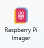
2. 打开烧录工具，点击「选择设备」→ 选择 **Raspberry Pi 5**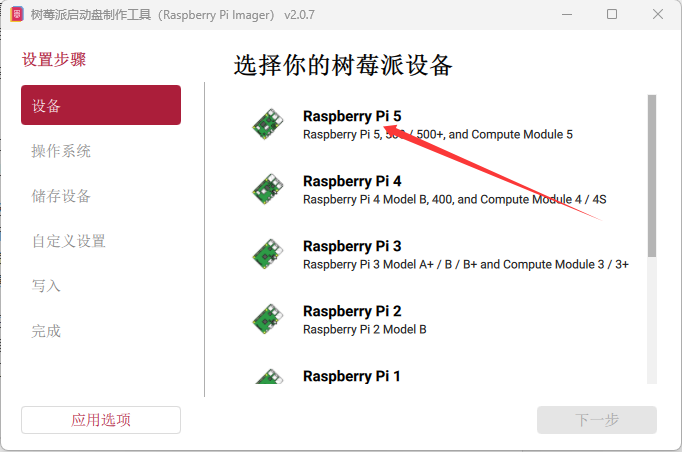
3. 点击「选择操作系统」→ **Other general-purpose OS** → **Ubuntu** → **Ubuntu Desktop 24.04 LTS (64-bit)**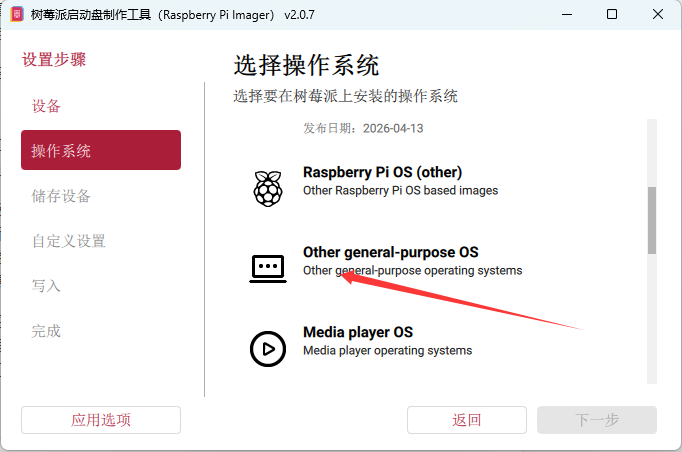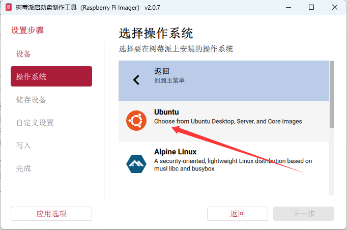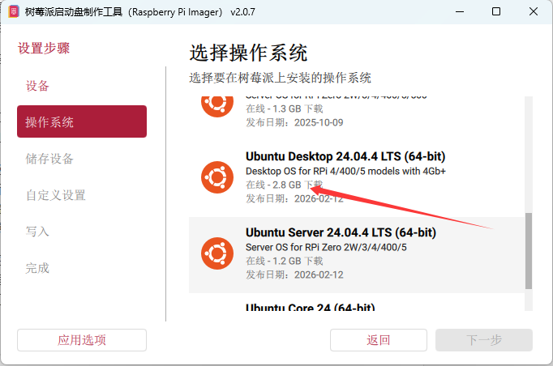
4. 将 SD 卡或硬盘接入电脑，点击「选择存储设备」→ 选择目标存储设备
5. 点击「下一步」→ 在弹出的设置中配置（此步骤可能会自动跳过）：
   - 设置主机名（如 `raspberrypi`）
   - 设置用户名和密码（建议设置简单易记的组合，如用户名 `ubuntu`，密码 `123456`）
   - 选择时区：**Asia/Shanghai**
   - 勾选「配置无线局域网」并输入 WiFi 密码
   - 勾选「启用 SSH」→ 使用密码认证
6. 点击「写入」→ 等待烧录完成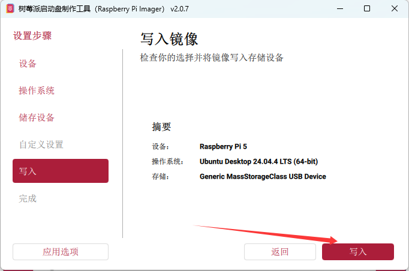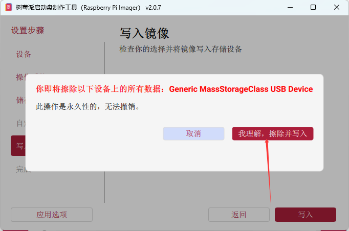
7. 将 SD 卡/硬盘插入树莓派，连接显示器、键盘、鼠标，上电启动

> ⚠️ 树莓派5 仅支持 Ubuntu 24.04 及以上版本，不支持 22.04。对应的 ROS2 版本为 Jazzy。

------

## 第二章 Ubuntu 系统初始配置

### 2.1 首次启动

首次启动会进入 Ubuntu 欢迎界面，按提示完成语言、网络、用户设置。若烧录时已完成配置则跳过此步骤。

1. 树莓派首次启动时会进行初始配置，包括语言、网络、时区、用户名等设置。建议暂时不连接网络，时区设置为上海，语言可根据个人偏好选择。

   
   上图为用户名设置界面，建议设置简单易记的用户名和密码，避免后续频繁输入时带来不便。

2. 设置中文语言

   打开系统设置应用

   
   进入语言设置界面，下载并安装汉语语言包

   
   安装完成后，汉语语言包会出现在语言列表中

   
   将「汉语(中国)」拖至列表顶部，完成中文设置

   

3. 系统设置选项丰富，建议大家自行探索学习 Ubuntu 操作系统的基本使用方法。

### 2.2 终端操作

#### 找到终端

在树莓派的使用过程中，大部分操作需要通过 Ubuntu 操作系统的终端完成。终端应用如下图所示：


若桌面左侧未显示终端图标，可点击左下角的应用启动器：


在应用列表中找到「终端」，右键点击并选择「固定到快捷栏」，即可将其添加到桌面左侧：


打开终端后的界面如下：


### 2.3 连接网络

确保树莓派已连接 WiFi 或有线网络，后续所有操作都需要网络。

### 2.4 更新系统

打开终端（快捷键：`Ctrl+Alt+T`），执行以下命令更新系统：

```bash
sudo apt update
sudo apt upgrade -y
```

### 2.5 安装基础工具

执行以下命令安装常用工具：

```bash
sudo apt install -y vim git curl wget net-tools htop
```

各工具用途说明：

| 工具        | 用途                                                         |
| ----------- | ------------------------------------------------------------ |
| `vim`       | 终端文本编辑器，用于编辑配置文件（如 yaml、lua、launch.py 等） |
| `git`       | 版本控制工具，用于克隆雷达驱动等 GitHub 仓库                 |
| `curl`      | 命令行下载工具，添加 ROS2 软件源时需要                       |
| `wget`      | 命令行下载工具，下载鱼香 ROS 安装脚本等资源时需要            |
| `net-tools` | 网络诊断工具集，提供 `ifconfig` 等命令查看 IP 和网络状态     |
| `htop`      | 系统资源监控工具，实时查看 CPU、内存占用，排查树莓派卡顿问题 |

后续操作会涉及这些工具的使用，建议大家熟悉基本操作方法。

### 2.6 终端操作

Ubuntu 系统的大部分操作都可以通过终端命令完成。以下是一些常用的 Ubuntu 终端命令，供大家参考：

**📁 文件与目录操作（常用）**

| 命令           | 说明                 | 常用示例                                                    |
| -------------- | -------------------- | ----------------------------------------------------------- |
| `ls`           | 列出当前目录内容     | `ls -l`（查看详细信息）                                     |
| `cd`           | 切换目录             | `cd ~`（返回主目录）                                        |
| `pwd`          | 显示当前路径         | `pwd`                                                       |
| `cp`           | 复制文件/目录        | `cp file1 file2`，`cp -r dir1 dir2`（复制目录）             |
| `mv`           | 移动/重命名文件      | `mv old.txt new.txt`                                        |
| `rm`           | 删除文件/目录（谨慎）| `rm file`，`rm -r dir`（删除目录）                          |
| `mkdir`        | 创建新目录           | `mkdir new_folder`                                          |
| `cat` / `less` | 查看文件内容         | `cat file`（短文件），`less log.txt`（长文件，按 `q` 退出） |

**📦 软件管理**

| 命令                      | 说明                             |
| ------------------------- | -------------------------------- |
| `sudo apt update`         | 更新软件源列表（安装前必执行）   |
| `sudo apt install <包名>` | 安装指定软件                     |
| `sudo apt remove <包名>`  | 卸载指定软件                     |
| `sudo apt upgrade`        | 升级所有已安装的软件             |

**🔧 系统管理与权限**

| 命令            | 说明                                       |
| --------------- | ------------------------------------------ |
| `sudo <命令>`   | 以管理员权限执行命令（需要输入密码）       |
| `chmod +x file` | 给文件添加可执行权限                       |
| `ps aux`        | 查看所有正在运行的进程                     |
| `kill <PID>`    | 结束指定 PID 的进程                        |
| `df -h`         | 查看磁盘空间（-h 为易读格式）              |
| `top`           | 实时查看系统资源占用（类似任务管理器）     |

**🌐 网络相关**

| 命令          | 说明                     |
| ------------- | ------------------------ |
| `ping <网址>` | 测试网络是否连通         |
| `ssh user@ip` | 远程登录到另一台电脑     |
| `wget <网址>` | 下载文件                 |

**📝 文本处理**

| 命令               | 说明                                 |
| ------------------ | ------------------------------------ |
| `grep "文本" file` | 在文件中搜索指定文本                 |
| `tail -f log.txt`  | 实时追踪日志文件更新（调试常用）     |

### 终端操作小技巧

- **入门三指令：**
  1. 查看当前目录内容 → `ls`
  2. 安装新软件 → `sudo apt install 软件名`
  3. 查看文件内容 → `cat 文件名` 或 `less 文件名`

- **实用技巧：**
  - 按 `Tab` 键可自动补全文件名和命令，避免拼写错误
  - 任何命令后加 `--help` 可查看简要帮助信息，如 `ls --help`
  - 使用方向键上下可查看历史命令

Ubuntu 作为一种操作系统，熟悉基本操作需要一定时间，建议大家在实践中逐步掌握。

------

## 第三章 安装 ROS2 Jazzy

### 3.1 一键安装（推荐）

使用鱼香 ROS 一键安装脚本：

```bash
wget http://fishros.com/install -O fishros && . fishros
```

> 该命令来源于 [鱼香 ROS](https://fishros.com/)，这是一个提供 ROS 相关资源和教程的网站。

运行脚本后按照以下步骤操作：

1. 输入 `1` → 选择安装 ROS
2. 建议选择 `2` → 不换源下载
3. 选择 `ROS2 Jazzy 桌面版`，相关选项均选择 `1`

等待安装完成。

### 3.2 手动安装

若一键安装失败，可按照以下步骤手动安装：

```bash
# 设置 locale
sudo apt update && sudo apt install locales
sudo locale-gen en_US en_US.UTF-8
sudo update-locale LC_ALL=en_US.UTF-8 LANG=en_US.UTF-8
export LANG=en_US.UTF-8

# 添加 ROS2 软件源
sudo apt install software-properties-common
sudo add-apt-repository universe
sudo apt update && sudo apt install curl -y
sudo curl -sSL https://raw.githubusercontent.com/ros/rosdistro/master/ros.key -o /usr/share/keyrings/ros-archive-keyring.gpg
echo "deb [arch=$(dpkg --print-architecture) signed-by=/usr/share/keyrings/ros-archive-keyring.gpg] http://packages.ros.org/ros2/ubuntu $(. /etc/os-release && echo $UBUNTU_CODENAME) main" | sudo tee /etc/apt/sources.list.d/ros2.list > /dev/null

# 安装 ROS2 Jazzy
sudo apt update
sudo apt install ros-jazzy-desktop -y
```

### 3.3 配置环境变量

执行以下命令配置 ROS2 环境变量：

```bash
echo "source /opt/ros/jazzy/setup.bash" >> ~/.bashrc
source ~/.bashrc
```

> 上述命令的作用是将 `source /opt/ros/jazzy/setup.bash` 写入 `~/.bashrc` 文件，这样每次打开终端时都会自动加载 ROS2 环境。

### 3.4 验证安装

执行以下命令验证 ROS2 安装是否成功：

```bash
ros2
```

若输出 ROS2 版本信息，说明安装成功。示例输出如下：

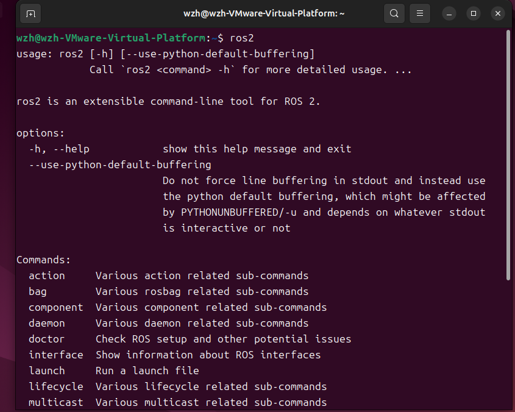

------

## 第四章 创建 ROS2 工作空间

### 4.1 创建工作空间目录

执行以下命令创建 ROS2 工作空间目录：

```bash
mkdir -p ~/ros2_ws/src  # 在主目录下创建 ros2_ws 文件夹及其子目录 src
cd ~/ros2_ws            # 切换到 ros2_ws 目录
```

### 4.2 编译空工作空间

执行以下命令编译工作空间：

```bash
colcon build
source install/setup.bash  # 编译后执行，后续配置环境变量后无需手动输入
```

编译完成后，主目录中会生成 `ros2_ws` 文件夹：


`ros2_ws` 目录中除了我们创建的 `src` 文件夹外，还会生成三个编译产物目录：


### 4.3 设置工作空间环境变量

执行以下命令设置工作空间环境变量：

```bash
echo "source ~/ros2_ws/install/setup.bash" >> ~/.bashrc
source ~/.bashrc
```

上述操作本质上是在 `~/.bashrc` 文件中添加 `source ~/ros2_ws/install/setup.bash` 命令。也可以通过手动编辑方式添加：

1. 打开终端，执行以下命令：

   ```bash
   nano ~/.bashrc
   ```
回车后如下：
2. 在文件末尾添加：

   ```
   source ~/ros2_ws/install/setup.bash
   ```

3. 按 `Ctrl+O`回车保存，然后按 `Ctrl+X` 退出。

手动编辑的效果与执行 `echo` 命令的效果完全相同。

至此，环境变量配置完成。大家跟着敲敲敲，敲了这么多指令，可能都云里雾里根本不知道自己在干啥，为了帮助大家深入理解上述操作的原理，下面对相关概念和技术机制进行详细说明。

> ### Shell 与 .bashrc 文件详解
>
> #### 1. 什么是 Shell？
>
> **Shell** 是操作系统内核与用户之间的接口程序，它接收用户输入的命令（如在终端中敲入的指令或图形界面中的点击操作），将这些命令翻译成操作系统能理解的指令，并交由内核执行。
>
> 简单来说，Shell 就像一位"翻译官"：用户通过它输入自然语言风格的命令，Shell 负责将这些命令转换为计算机能理解的语言并执行。从功能划分，Shell 可分为：
>
> - **命令行 Shell**：如 Bash、Zsh 等，通过文本命令交互
> - **图形界面 Shell**：如 GNOME、KDE 等，通过桌面图标、窗口、菜单交互
>
> #### 2. 什么是 .bashrc？
>
> `.bashrc` 是 Bash Shell 的运行时配置文件，其特点如下：
>
> | 特性 | 说明 |
> |------|------|
> | 隐藏文件 | 文件名以 `.` 开头，在文件管理器中默认不显示 |
> | 位置 | 位于用户主目录下（`~/.bashrc`） |
> | 触发条件 | 启动**交互式、非登录** Shell 时自动执行 |
>
> 这意味着：每次打开一个新的终端窗口，系统都会自动读取并执行 `.bashrc` 文件中的所有命令。
>
> #### 3. 什么是 nano 编辑器？
>
> `nano` 是 Ubuntu 系统自带的文本编辑器。使用 `nano ~/.bashrc` 命令可以打开 `.bashrc` 文件进行编辑。编辑完成后，按 `Ctrl+O` 保存，`Ctrl+X` 退出。
>
> ### ROS2 工作空间环境配置详解
>
> #### 1. `source` 命令的作用
>
> `source` 是 Shell 内建命令，用于在**当前 Shell 环境中**读取并执行指定文件中的命令。与直接运行脚本不同，`source` 执行过程中的所有环境变量修改都会保留在当前会话中。
>
> 理解方式：执行 `source 脚本.sh` 等同于将脚本中的所有命令逐行敲入当前终端执行。
>
> #### 2. `setup.bash` 文件的作用
>
> 当使用 `colcon build` 编译 ROS2 工作空间后，系统会在 `install` 目录下生成多个环境设置脚本，其中最重要的是 `setup.bash`。
>
> 执行 `source ~/ros2_ws/install/setup.bash` 后，该脚本会完成以下工作：
>
> **（1）添加工作空间到 ROS2 环境**
>
> - 使工作空间中编写的**功能包**、**节点**、**消息**、**服务**等能被 ROS2 系统识别和使用
>
> **（2）设置关键环境变量**
>
> | 环境变量 | 作用 |
> |----------|------|
> | `ROS_PACKAGE_PATH` | 添加工作空间路径，使 `ros2 run`、`ros2 launch` 等命令能定位到你的功能包 |
> | `PATH` | 添加 `install` 目录下可执行文件路径，使你可直接运行编写的节点 |
> | `LD_LIBRARY_PATH` | 添加 `install` 目录下库文件（.so）路径，确保运行时能找到依赖库 |
> | `PYTHONPATH` | 添加 Python 模块路径，便于 Python 解释器导入 ROS2 Python 包 |
>
> **（3）启用命令自动补全**
>
> - 为自定义包、节点、launch 文件等提供 `ros2` 命令的自动补全功能
>
> #### 3. 为什么要写入 .bashrc？
>
> 由于 `source` 命令的效果仅在**当前终端会话**中有效——关闭终端后，所有环境变量设置都会丢失。因此，如果每次打开新终端都需要手动执行 `source` 命令，这会非常繁琐。
>
> 将 `source ~/ros2_ws/install/setup.bash` 写入 `.bashrc` 文件后，每次打开新终端时，系统会自动执行该命令，从而自动加载 ROS2 工作空间的环境变量。
>
> ### 小结
>
> 所谓"环境配置"，本质上是通过一系列设置，将原本需要手动重复执行的操作改为自动执行，从而简化开发流程、提升效率。回顾本章内容，环境配置的具体目标就是：**使 `source ~/ros2_ws/install/setup.bash` 命令能够在每次打开新终端时自动执行**，省去手动重复输入的繁琐过程。
>
> 实现这一目标的途径是：将上述 `source` 命令写入 `.bashrc` 文件。这样，每次启动终端时，系统会自动读取并执行 `.bashrc`，从而自动加载 ROS2 工作空间的环境变量。
> 

------

## 第五章 安装 N10 雷达驱动

本章内容皆可参考轮趣科技官方的说明文档：[镭神雷达LSLidar的ROS2驱动使用说明20240228](https://github.com/Flightsquadyeah/The-SLAM-of-Raspberrypi5b-and-ROS2-and-N10radar/blob/main/Instruction/镭神雷达LSLidar的ROS2驱动使用说明20240228.pdf)进入我的Github组可前往连接直接查看。当然该文档也可在配套文件`Instruction`文件夹里找到。

### 5.1 获取驱动功能包

将LSLIDAR_X_ROS文件夹拷贝到用户的工作空间的src目录下，该文件夹在配套文件的`Pakage`文件夹里

### 5.2 安装驱动依赖

```bash
sudo apt install -y python3-colcon-common-extensions

sudo apt install -y ros-jazzy-diagnostic-updater

sudo apt install -y libpcap-dev
```

### 5.3 驱动目录结构

克隆完成后，驱动目录结构如下：

```
LSLIDAR_X_ROS2-20240228/
├── src/
│   ├── lslidar_driver/
│   │   ├── launch/          # 启动文件（lsm10/lsm10p/lsn10/lsn10p等型号）
│   │   ├── params/          # 参数配置文件（yaml）
│   │   ├── src/             # 源码（input.cc、lslidar_driver.cc等）
│   │   ├── include/         # 头文件（input.h、lslidar_driver.h等）
│   │   ├── rviz/            # RViz配置文件
│   │   ├── CMakeLists.txt   # CMake配置文件
│   │   └── package.xml      # 包配置文件
│   ├── lslidar_msgs/        # 自定义消息定义（LslidarScan、LslidarPoint等）
│   ├── README.md            # 说明文档
│   ├── version.txt          # 版本信息
│   ├── wheeltec_udev.sh     # Udev规则脚本
│   └── 镭神Lsx雷达旋转角度.png  # 雷达旋转角度说明图
└── wheeltec_lidar.launch.py # 启动文件（WHEELTEC镜像专用）
```

------

## 第六章 配置雷达串口

### 6.1 查找雷达串口号

将 N10 雷达通过转接板 USB 连接到树莓派，然后在终端查看：

```bash
ls /dev/ttyUSB* /dev/ttyACM*
```

通常输出类似：

```
/dev/ttyUSB0
```

或

```
/dev/ttyACM0
```

> 💡 如果没有任何输出，说明 USB 转串口驱动未加载。N10 雷达使用 CH9102（我们用的） 或 CH343 或 CP2102 芯片，Ubuntu 24.04 通常自带驱动。如果未识别，尝试：
>
> ```bash
> sudo apt install linux-firmware
> sudo reboot
> ```

### 6.2 添加串口权限

```bash
sudo usermod -aG dialout $USER
sudo chmod 666 /dev/ttyUSB0
```

> ⚠️ 添加用户组后需要**注销重新登录**或**重启**才能生效。

### 6.3 配置串口别名（推荐）

串口号（ttyUSB0、ttyUSB1 等）在重新插拔后可能变化，建议配置固定别名：

> 串口别名是什么：简单来说，**串口别名就是一个由你自定义的、固定的设备名字**，用来代替系统自动分配的那些容易变化的串口设备文件（比如 `/dev/ttyUSB0`、`/dev/ttyUSB1`）。
>
> 为什么要串口别名呢？树莓派获取雷达数据，肯定需要雷达接入树莓派的串口，而雷达驱动的配置中需要配置确定的串口名称，用于确定接收雷达数据的串口具体是哪一个。如若不设置串口别名就会出现如下情况：
>
> 当你插入USB转串口设备时，系统会自动分配设备名称：
>
> ```bash
> # 第一次插入两个设备
> 雷达 → /dev/ttyUSB0
> IMU  → /dev/ttyUSB1
> 
> # 重启后或拔插顺序变化后
> 雷达 → /dev/ttyUSB1  # 顺序变了！
> IMU  → /dev/ttyUSB0  # 完全混乱！
> ```

**第一步：查看雷达 USB 设备信息**

设置别名需要获取设备的四个关键信息：**厂商ID（idVendor）、产品ID（idProduct）、Kernel名称、串口号（Serial）**。

**查看Kernel名称**
在终端中输入以下命令之一（因为转接板可能不同，你要自己尝试哪个是对的，我们一般都用第二行的命令，无需安装驱动使用CH9102）：

```bash
ll /dev | grep ttyUSB    # 通常用于CP2102
ll /dev | grep ttyACM    # 通常用于未装驱动的CH9102
ll /dev | grep ttyCH343  # 通常用于已安装驱动的CH9102
```


输出结果中的 `ttyUSB0`、`ttyACM0` 等即为Kernel名称。包括之后带有`ttyUSB`或`ttyACM0`的指令都已你们自己的Kernel名称修改，不要直接复制我给的指令。

**查看厂商ID（idVendor）、产品ID（idProduct）、串口号（Serial）**

```bash
udevadm info --attribute-walk --name=/dev/ttyACM0 | grep -E "idVendor|idProduct|serial"
```
会返回以下内容：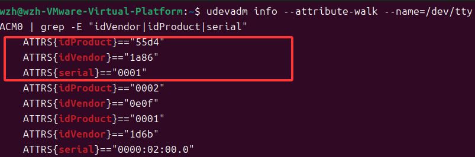

记录我标红框中输出的的 `idVendor`、`idProduct` 和 `serial` 值。红框外的可能是因为我用的虚拟机的虚拟USB控制器，大家如果大家也不只显示这三项，不会判断也可用以下方式获取：

> **查看串口号（Serial）**
>
> ```bash
> sudo udevadm info /dev/ttyACM0 | grep ID_SERIAL_SHORT
> ```
>
> **查看厂商ID和产品ID**
>
> ```
> lsusb
> ```
>
> 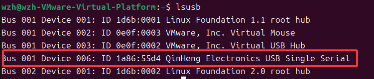
>
> - 找到 `Silicon Labs CP210x UART Bridge` 或 `Qinheng Electronics` 行。
>
> - 其格式为 `ID xxxx:yyyy`，其中 `xxxx` 是**厂商ID**，`yyyy` 是**产品ID**。
>
> - 💡 常见 USB 转串口芯片的 idVendor/idProduct：
>
>   - CH340/CH343/CH9102：`1a86` / `7523` 或 `1a86` / `55d3`
>   - CP2102：`10c4` / `ea60`
>   - FT232：`0403` / `6001`
>
>   请以你实际查到的为准。

**第二步：创建 udev 规则**

在终端输入以下内容（根据你的 kernel、idVendor 和、idProduct 和 serial 修改）：

```bash
sudo echo 'KERNEL=="ttyACM*", ATTRS{idVendor}=="1a86", ATTRS{idProduct}=="55d4", ATTRS{serial}=="0001", MODE:="0777", GROUP:="dialout", SYMLINK+="wheeltec_laser"' > /etc/udev/rules.d/wheeltec_lidar.rules
```

如显示权限不够就改为以下代码：

```bash
echo 'KERNEL=="ttyACM*", ATTRS{idVendor}=="1a86", ATTRS{idProduct}=="55d4", ATTRS{serial}=="0001", MODE:="0777", GROUP:="dialout", SYMLINK+="wheeltec_laser"' | sudo tee /etc/udev/rules.d/wheeltec_lidar.rules
```

> **命令参数解释：**
>
> - `KERNEL=="ttyACM*"`: 匹配设备内核名称。
> - `ATTRS{idVendor}=="1a86"`: 匹配厂商ID。
> - `ATTRS{idProduct}=="55d4"`: 匹配产品ID。
> - `ATTRS{serial}=="0001"`: **匹配串口号（关键区分项）**。
> - `MODE:="0777"`: 设置设备权限为所有用户可读可写可执行。
> - `GROUP:="dialout"`: 将设备归属到`dialout`用户组。
> - `SYMLINK+="wheeltec_laser"`: **创建别名**，这是最核心的部分。

**第三步：使规则生效**

```bash
sudo udevadm control --reload-rules #重新加载 udev 规则
sudo udevadm trigger  #触发规则
```

**第四步：验证别名**

拔插雷达 USB 后执行：

```bash
ls -l /dev/wheeltec_laser
```

如果输出类似 `/dev/wheeltec_laser -> ttyUSB0`，说明别名配置成功，如下：


> **串口别名的实质：**
>
> 串口别名的过程，也就是我们在终端所输入的指令，本质就是在`/etc/udev/rules.d`这个文件夹中创建了一个名为`wheeltec_lidar.rules`文件。`rules.d`是存放**用户自定义规则**的文件夹，而我们写的`.rules`文件就是我们自定义的规则，这个规则的内容就是：
>
> ```bash
> KERNEL=="ttyACM*", ATTRS{idVendor}=="1a86", ATTRS{idProduct}=="55d4", ATTRS{serial}=="0001", MODE:="0777", GROUP:="dialout", SYMLINK+="wheeltec_laser"
> ```
>
> 也就说大家串口别名也可以在`/etc/udev/rules.d`中写一个名为`wheeltec_lidar.rules`的文件，文件中写入上面内容也可完成串口别名。当然其实我给出的指令实际就是执行以上的行为，只是压缩成了一行指令代为执行。

### 6.4 修改雷达配置文件

编辑 N10 雷达的 yaml 配置文件：

```bash
nano ~/ros2_ws/src/LSLIDAR_X_ROS2-20240228/src/lslidar_driver/params/lidar_net_ros2/lsn10_net.yaml
```

也可以不用nano，直接按照对应路径用各种编辑器打开，进行改写。

修改参数如下：

```yaml
/lslidar_driver_node:
  ros__parameters: 
    frame_id: laser                                       #激光坐标
    group_ip: 224.1.1.2
    add_multicast: false 
    device_ip: 192.168.1.200                   	            #雷达源IP
    device_ip_difop: 192.168.1.102                          #雷达目的ip
    msop_port: 2368                                         #雷达目的端口号
    difop_port: 2369                                        #雷达源端口号
    lidar_name: N10                                         #雷达选择:M10 M10_P M10_PLUS M10_GPS N10 L10 N10_P
    angle_disable_min: 0.0                                  #角度裁剪开始值
    angle_disable_max: 0.0                                  #角度裁剪结束值
    min_range: 0.2                                          #雷达接收距离最小值
    max_range: 200.0                                        #雷达接收距离最大值
    use_gps_ts: false                                       #雷达是否使用GPS授时
    scan_topic: /scan                                       #设置激光数据topic名称
    interface_selection: net                             #接口选择:net 为网口,serial 为串口。
    serial_port_: /dev/wheeltec_laser                              #串口连接时的串口号
    high_reflection: false                                  #M10_P雷达需填写该值,若不确定，请联系技术支持。
    compensation: false				                              #M10系列是否使用角度补偿功能
    pubScan: true                                           #是否发布scan话题
    pubPointCloud2: false                                    #是否发布pointcloud2话题
    pointcloud_topic: /lslidar_point_cloud                  #设置激光数据topic名称
#    pcap: /home/ls/1.pcap                                  #雷达是否使用pcap包读取功能
#    in_file_name: /home/ls/1.txt                           #雷达是否使用txt文件读取功能
```

> ⚠️ `serial_port_` 必须与你实际的串口路径一致。如果没配置别名，就写 `/dev/ttyACM0`。
>  ⚠️ `frame_id` 设为 `laser`，后续 Cartographer 配置要与此一致。

------

## 第七章 编译并测试雷达驱动

### 7.1 编译驱动

```bash
cd ~/ros2_ws
colcon build 
source install/setup.bash
```

> 💡 如果编译报错缺少依赖，根据提示安装。常见依赖：
>
> ```bash
> sudo apt install -y ros-jazzy-tf2-ros ros-jazzy-tf2-sensor-msgs
> ```

### 7.2 启动雷达

```bash
ros2 launch lslidar_driver lsn10_launch.py #我们用的是N10雷达所以用lsn10_launch.py这个启动文件
```

### 7.3 验证雷达数据

**另开一个终端**，执行：

```bash
# 查看话题列表
ros2 topic list

# 查看雷达扫描话题
ros2 topic echo /scan --once

# 查看话题发布频率
ros2 topic hz /scan
```

如果 `/scan` 话题有数据输出，且频率在 10Hz 左右，说明雷达驱动正常。

### 7.4 用 RViz2 可视化

```bash
rviz2
```


在 RViz2 中：

1. 点击左下角 `Add`

2. 选择 `By topic` → `/scan` → `LaserScan`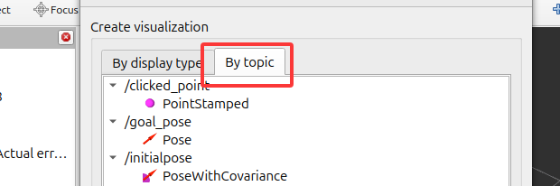

3. 将左侧 `Fixed Frame` 改为 `laser`

   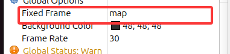

如果能看到各种颜色的激光扫描点，说明雷达完全正常工作。


------

## 第八章 安装 Cartographer

### 8.1 apt 安装（推荐）

ROS2 Jazzy 已适配 Cartographer，可直接 apt 安装：

```bash
sudo apt update
sudo apt install -y ros-jazzy-cartographer ros-jazzy-cartographer-ros
```

### 8.2 验证安装

```bash
ros2 pkg list | grep cartographer
```

应输出：

```
cartographer
cartographer_ros
```

### 8.3 安装地图保存工具

```bash
sudo apt install -y ros-jazzy-nav2-map-server #该教程暂时用不到
```
### 8.4 克隆laser_scan_matcher功能包

一般在github上克隆，但是克隆很大概率失败，可能链接不对也可能网络问题。大家可以问问ai如何克隆，这里我把该功能包放在了配套文件的`Pakage`文件夹中，其中还有该功能包所需要的依赖。大家可以直接复制到工作空间的`src`文件夹里。

也可直接在Github获取，连接：[Package](https://github.com/Flightsquadyeah/The-SLAM-of-Raspberrypi5b-and-ROS2-and-N10radar/tree/main/Package)

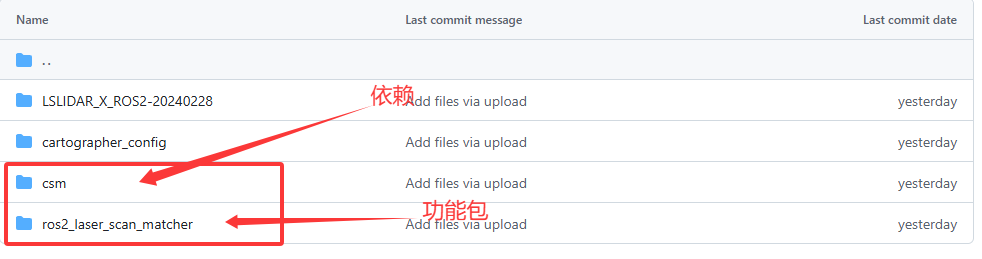

直接复制到工作空间的`src`文件夹里：


> 简单来说，`laser_scan_matcher` 的核心作用就是：**纯粹利用激光雷达的数据，来推算出机器人的位置和姿态（位姿）变化，充当机器人的“伪里程计”。**
>
> 接下来的算法配置文件中，会有一个名为odom的里程计坐标系，这个坐标系本应用惯导或者其他imu提供，但是我们没有这类硬件，就用该算法包充伪里程计代替惯导的作用，使建图更稳定减少飘逸。

------

## 第九章 配置 Cartographer 建图文件

Cartographer 需要两个配置文件：**Lua 配置文件**（算法参数）和 **Launch 文件**（启动参数）。该建图文件也以上传至Github，在配套文件的`Package`文件夹里，可直接取用，建议按照以下流程自己配一下试一试：

### 9.1 创建配置目录

```bash
mkdir -p ~/ros2_ws/src/cartographer_config/configuration_files
```

### 9.2 编写 Lua 配置文件

```bash
nano ~/ros2_ws/src/cartographer_config/configuration_files/n10_2d.lua
```

写入以下内容：

```lua
- 包含必要的构建器文件
include "map_builder.lua"           -- 地图构建器配置
include "trajectory_builder.lua"    -- 轨迹构建器配置

-- 主要配置选项
options = {
  map_builder = MAP_BUILDER,                    -- 地图构建器实例
  trajectory_builder = TRAJECTORY_BUILDER,      -- 轨迹构建器实例
  
  -- 坐标系设置
  map_frame = "map",                    -- 地图坐标系名称
  tracking_frame = "laser",             -- 追踪帧（激光雷达坐标系）
  published_frame = "base_link",        -- 发布的基坐标系
  odom_frame = "odom",                  -- 里程计坐标系
  provide_odom_frame = true,            -- 是否提供odom到base_link的TF变换
  publish_frame_projected_to_2d = true, -- 将发布的帧投影到2D平面
  
  -- 传感器使用配置
  use_pose_extrapolator = true,         -- 使用位姿推断器
  use_odometry = true,                  -- 使用里程计数据
  use_nav_sat = false,                  -- 不使用GPS数据
  use_landmarks = false,                -- 不使用地标数据
  
  -- 激光雷达配置
  num_laser_scans = 1,                  -- 使用1个单线激光雷达
  num_multi_echo_laser_scans = 0,       -- 不使用多回波激光雷达
  num_subdivisions_per_laser_scan = 1,  -- 每束激光扫描的分割数
  num_point_clouds = 0,                 -- 不使用点云数据
  
  -- 时间参数
  lookup_transform_timeout_sec = 0.2,   -- TF变换查找超时时间（秒）
  submap_publish_period_sec = 0.3,      -- 子图发布周期（秒）
  pose_publish_period_sec = 5e-3,       -- 位姿发布周期（秒，200Hz）
  trajectory_publish_period_sec = 30e-3,-- 轨迹发布周期（秒）
  
  -- 数据采样比例
  rangefinder_sampling_ratio = 1.,      -- 测距仪数据采样比例（100%）
  odometry_sampling_ratio = 1.,         -- 里程计数据采样比例（100%）
  fixed_frame_pose_sampling_ratio = 1., -- 固定帧位姿采样比例
  imu_sampling_ratio = 1.,              -- IMU数据采样比例
  landmarks_sampling_ratio = 1.,        -- 地标数据采样比例
}

-- 地图构建器配置：使用2D轨迹构建器
MAP_BUILDER.use_trajectory_builder_2d = true

-- 2D轨迹构建器参数配置
TRAJECTORY_BUILDER_2D.submaps.num_range_data = 35  -- 每个子图包含的激光扫描次数
TRAJECTORY_BUILDER_2D.min_range = 0.               -- 最小检测范围（米）
TRAJECTORY_BUILDER_2D.max_range = 50.              -- 最大检测范围（米）
TRAJECTORY_BUILDER_2D.missing_data_ray_length = 5. -- 缺失数据的射线长度（米）
TRAJECTORY_BUILDER_2D.use_imu_data = false         -- 不使用IMU数据

-- 在线相关性扫描匹配配置
TRAJECTORY_BUILDER_2D.use_online_correlative_scan_matching = true  -- 启用在线相关性扫描匹配
TRAJECTORY_BUILDER_2D.real_time_correlative_scan_matcher.linear_search_window = 0.1    -- 线性搜索窗口大小（米）
TRAJECTORY_BUILDER_2D.real_time_correlative_scan_matcher.translation_delta_cost_weight = 10.   -- 平移变化代价权重
TRAJECTORY_BUILDER_2D.real_time_correlative_scan_matcher.rotation_delta_cost_weight = 1e-1     -- 旋转变化代价权重

-- 位姿图优化配置
POSE_GRAPH.optimization_problem.huber_scale = 1e2  -- Huber损失函数尺度参数
POSE_GRAPH.optimize_every_n_nodes = 35             -- 每35个节点执行一次优化
POSE_GRAPH.constraint_builder.min_score = 0.65     -- 约束构建的最小分数阈值

-- 返回配置选项
return options

```

**关键参数说明：**

| 参数                                   | 值             | 说明                                    |
| -------------------------------------- | -------------- | --------------------------------------- |
| `tracking_frame`                       | `"laser"`      | 必须与雷达 yaml 中的 `frame_id` 一致    |
| `published_frame`                      | `"base_link"`  | 发布的坐标系                            |
| `provide_odom_frame`                   | `true`         | 无里程计时由 Cartographer 提供虚拟 odom |
| `use_odometry`                         | `false`        | 无轮式里程计，设为 false                |
| `use_imu_data`                         | `false`        | 无 IMU，设为 false                      |
| `num_laser_scans`                      | `1`            | 一个激光雷达                            |
| `min_range` / `max_range`              | `0.1` / `25.0` | N10 有效范围 0.1~25 米                  |
| `use_online_correlative_scan_matching` | `true`         | 无里程计时必须开启，用于扫描匹配        |

### 9.3 编写 Launch 文件

```bash
mkdir -p ~/ros2_ws/src/cartographer_config/launch
nano ~/ros2_ws/src/cartographer_config/launch/n10_cartographer.launch.py
```

写入以下内容：

```python
import os
from ament_index_python.packages import get_package_share_directory
from launch import LaunchDescription
from launch.actions import DeclareLaunchArgument, IncludeLaunchDescription
from launch.conditions import IfCondition
from launch.substitutions import LaunchConfiguration
from launch_ros.actions import Node
from launch.launch_description_sources import PythonLaunchDescriptionSource


def generate_launch_description():
    cartographer_config_dir = os.path.join(
        get_package_share_directory('cartographer_config'), 'configuration_files')
    configuration_basename = LaunchConfiguration('configuration_basename')

    cartographer_prefix = get_package_share_directory('cartographer_ros')

    return LaunchDescription([
        DeclareLaunchArgument(
            'configuration_basename',
            default_value='n10_2d.lua',
            description='Lua配置文件名'),

        DeclareLaunchArgument(
            'use_rviz',
            default_value='true',
            description='是否启动RViz2'),

        Node(
            package='cartographer_ros',
            executable='cartographer_node',
            name='cartographer_node',
            output='screen',
            arguments=['-configuration_directory', cartographer_config_dir,
                       '-configuration_basename', 'n10_2d.lua'],
            remappings=[('scan', '/scan')]),
            
        Node(
            package='tf2_ros',
            executable='static_transform_publisher',
            name='static_transform_publisher',
            arguments=['0', '0', '0', '0', '0', '0', 'base_link', 'laser'],
            ),

        Node(
            package='cartographer_ros',
            executable='cartographer_occupancy_grid_node',
            name='cartographer_occupancy_grid_node',
            output='screen',
            parameters=[{'resolution': 0.05}]),
            
        Node(
            package='ros2_laser_scan_matcher',     # ros2 run 的第一个参数：包名
            executable='laser_scan_matcher',         # ros2 run 的第二个参数：可执行文件名
            name='laser_scan_matcher',              # 节点名称（建议设）
            output='screen',                        # 日志输出到终端，方便看报错
        ),
           
        Node(
            condition=IfCondition(LaunchConfiguration('use_rviz')),
            package='rviz2',
            executable='rviz2',
            name='rviz2',
            output='screen'),
    ])
```

### 9.4 创建 package.xml 和 CMakeLists.txt

首先，进入配置包目录：

```bash
cd ~/ros2_ws/src/cartographer_config
```

**创建 package.xml：**

```bash
nano package.xml
```

粘贴以下内容：

```xml
<?xml version="1.0"?>
<package format="3">
  <name>cartographer_config</name>
  <version>0.0.1</version>
  <description>Cartographer configuration for N10 lidar</description>
  <maintainer email="user@example.com">user</maintainer>
  <license>Apache-2.0</license>

  <buildtool_depend>ament_cmake</buildtool_depend>

  <exec_depend>cartographer_ros</exec_depend>
  <exec_depend>rviz2</exec_depend>

  <export>
    <build_type>ament_cmake</build_type>
  </export>
</package>
```

编辑完成后，按 `Ctrl+O` 并回车写入，按`Ctrl+X`退出。

**创建 CMakeLists.txt：**

```bash
nano CMakeLists.txt
```

粘贴以下内容：

```cmake
cmake_minimum_required(VERSION 3.8)
project(cartographer_config)

find_package(ament_cmake REQUIRED)

install(DIRECTORY configuration_files/
  DESTINATION share/${PROJECT_NAME}/configuration_files)

install(DIRECTORY launch/
  DESTINATION share/${PROJECT_NAME}/launch)

ament_package()
```

编辑完成后，按 `Ctrl+O` 并回车写入，按`Ctrl+X`退出。

### 9.5 编译配置包

```bash
cd ~/ros2_ws
colcon build
source install/setup.bash
```

------

## 第十章 启动建图

### 10.1 启动雷达

**终端1**——启动雷达驱动：

```bash
ros2 launch lslidar_driver lsn10_launch.py
```

等待输出 `[INFO] [lslidar_driver]: Lslidar driver started` 表示雷达启动成功。

### 10.2 启动 Cartographer

**终端2**——启动 Cartographer 建图：

```bash
ros2 launch cartographer_config n10_cartographer.launch.py
```

### 10.3 在 RViz2 中查看建图

Cartographer 启动后会自动打开 RViz2。在 RViz2 中进行以下配置：

1. 将左侧 `Fixed Frame` 改为 `map`

   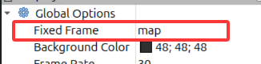

2. 点击 `Add` → `By topic`：

   - 添加 `/map` → `Map`（地图显示）
   - 添加 `/scan` → `LaserScan`（激光扫描显示）

3. 在 LaserScan 的属性中：
   - `Size (m)` → `0.05`（使点云变大）

现在你应该能看到地图在逐渐构建：


