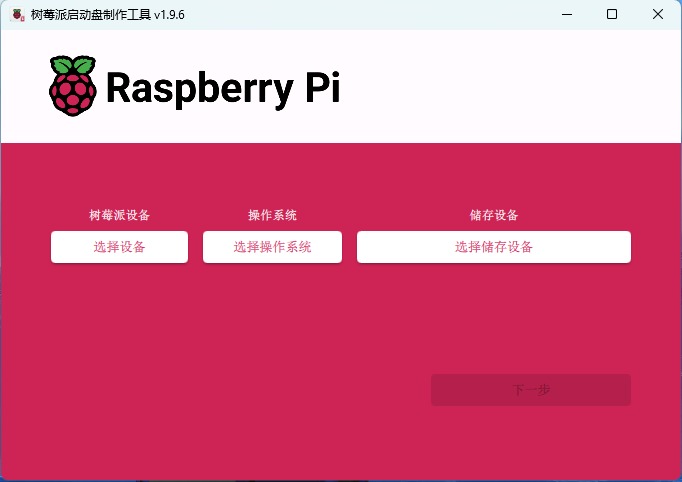
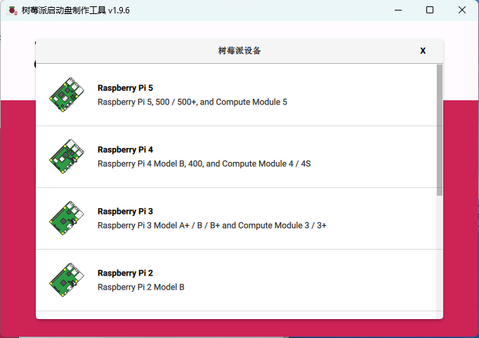
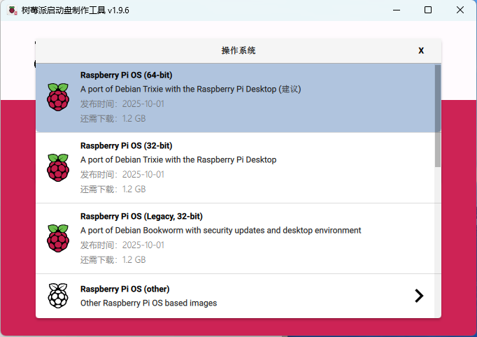
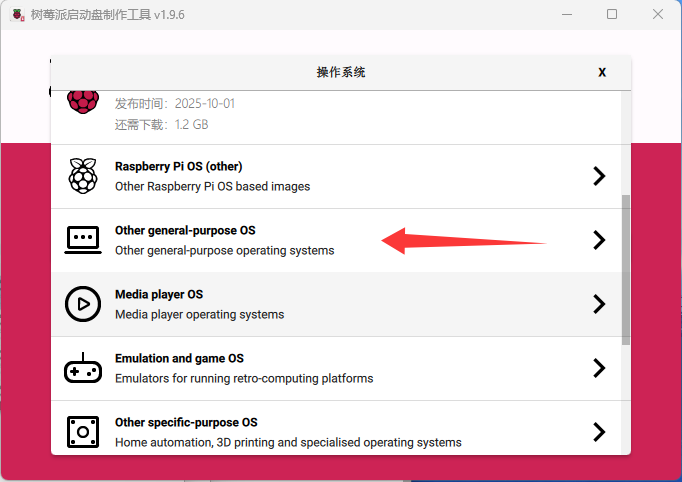
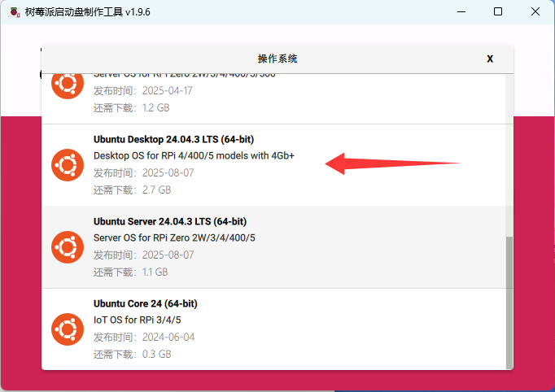
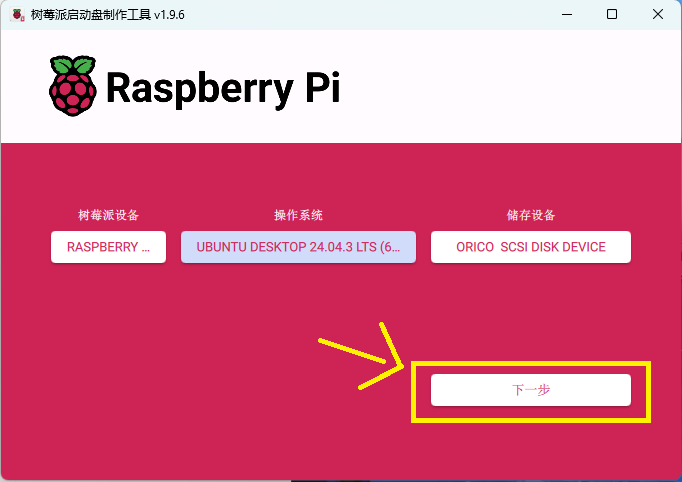
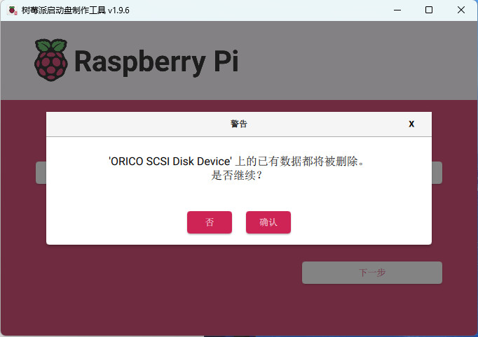

# 2025飞行器激光雷达建图方案

**原创**：赵立凯
**作者**：闫腾岳                                                                                                                                                                      ——**写于2025年11月**

--------


## 引言

多年以后，面对非洲贫瘠的大地，赵立凯回想起那个用树莓派建图把飞机调好的漆黑夜晚。时代的浪花淹没了每一个囿于舒适圈、止步不前的人，而电赛的荣誉总是属于那些敢于创新、一往无前的人。

树莓派，可能在国外被当作入门的玩具，而对于我们而言一定是迅速赶上时代的关键物品。简单说，树莓派就是一个只有信用卡大小的、相对便宜的微型电脑。我们在树莓派上安装ubuntu系统就可以使用ros2机器人操作系统处理雷达数据，利用激光雷达来感知周围环境的几何形状，同时利用这些几何信息来实时构建地图并确定自身在地图中的位置，这就是所谓的激光slam，俗称“建图”。

本文主要详细讲解赵立凯学长、王绍凯学长、张梓阳学长在2025年电赛国赛取得国二的建图方案。大家需要准备的东西有：一台电脑、一个显示器、键盘鼠标、装备齐全的树莓派、5V/5A的电源、micro HDMI（接树莓派）转HDMI（接显示器，也可能不是HDMI）线、激光雷达、CH9102F串口USB转TTL、CH340、若干A口转C口的USB线等。另外，本文以软件讲解为主，硬件操作只涉及必要部分，具体硬件细节可能涉及不到，可以现场询问学长。

为了方便大家查阅，我会把本文涉及的资料与本文放在一个文件夹里打包，发给大家。这些资料大多数都是ROS2的**Humble**版本的，而我们使用的ROS2是**jazzy**版本的，因为jazzy版本是24年发行的最新版本，第三方资料甚少，能给大家找到的大多都是Humble版本，大部分都是通用资料，个别内容大家需要区分修改，记得留意，当然本文每一步都会带着大家去操作，资料只起辅助作用。

基于以上，我们就可以开始学习建图了。最后稍微说明一下，以下建图方案全部基于赵立凯的言传身教，作为二次转述者，或因本人理解不深、能力有限，或表意不清词不达意，以下算是抛砖引玉仅供参考，方案并不完美，作为入门资料阅读、学习即可。希望在我写、你看的时候，我们能共同学习，共同传承，共同进步。

--------


## 给树莓派安装ubuntu系统（在你的windows系统电脑中操作）

### 镜像烧录工具

可以下载树莓派官方的烧录工具,如图所示       
> 官网下载链接->https://www.raspberrypi.com/software/

### 烧录工具使用

先准备一张SD卡或者有硬盘转接模块的可以准备一块固态硬盘，32G够用64G更好，跑视觉可能要更大的，实验室应该会有准备好的，这个不用太在意。

1. 打开烧录工具是这个样子的

     

​    

2. 点击   `选择设备`

    

    这里用的   哪个型号的树莓派选哪个就行，我们用的是Raspberry Pi 5

3. 返回去点击 `选择操作系统`去选择我们想要安装的操作系统

   

   打开是上面这样的，往下滚动

   

   点击图中箭头所指的选项`Other general-purpose OS`，进入下一级后选择`ubuntu`，选择`ubuntu Desktop24.04.3`

   为啥选择这个版本呢，因为赵立凯建图是用的这个，他的方案跟着他走。

4. 把你给树莓派准备的SD卡或硬盘接入电脑，点击`选择储存设备`选择接入的存储设备即可

5. 三项都选择完毕后，右下角的`下一步`会变高亮，点击即可
    

6. 点击确定，等待烧录完成即可

                                                    
--------


## Linux（ubuntu）系统初始配置与使用

### 初始配置

安装完ubuntu系统，就可以给树莓派接上硬盘或SD卡然后启动了，当然要给树莓派连接显示器和鼠标键盘。

1. 第一次启动树莓派会有初始配置，设置语言、网络、时区、用户名等，尽量先不要连接网络，时区设置上海，语言按你喜好了，会日语设成日语都行【狗头】。

   
   上图便是设置用户名的界面，最好把用户名和密码设置得简单好记，设复杂了等你天天要输密码就老实了。

2. 设置中文

   找到下图这个应用

   

   打开如下，图中圈出选项可以下载汉语语言包

   

   

   有了汉语语言包，它会出现在下图所示的位置

   

   把它`汉语(中国)`用鼠标拖到最顶部就设置完成了

   

3. 能设置的还有很多，不知道还能教啥了，自己学学ubuntu操作系统吧，不多讲了

### 终端操作

#### 找到终端

我们在使用树莓派时，大部分的操作都是在ubuntu操作系统的终端里进行的，就是下图这个东西 如果你的左侧没有，那么点击左下角那个小圈圈点开后就可以找到`终端`，对准它右击会出现三个选项，点击`固定到快捷栏`它就会到桌面的左侧了


#### 终端指令

进入终端，就会来到这样的对话框，你就可以在这敲指令来操作你的树莓派了

第一次启动，大家可以输入以下指令来更新升级系统文件

``` bash
sudo apt update   #更新软件索引（获取最新可用软件版本信息）
sudo apt upgrade  #升级所有已安装软件
```


在ubuntu上的一切操作都可以在终端用指令进行，指令大家自己去学吧，多敲两遍就记住了。下面是我找AI帮忙列的一些常用ubuntu指令，可作为参考：

**📁 文件与目录（每天都会用）**

| 命令           | 说明                 | 常用示例                                                    |
| :-------- | :-------- | :-------- |
| `ls`           | **列出**当前目录内容 | `ls -l`（看详情）                                           |
| `cd`           | **切换**目录         | `cd ~`（回家）                                              |
| `pwd`          | 显示**当前路径**     | `pwd`                                                       |
| `cp`           | **复制**文件/目录    | `cp file1 file2`，`cp -r dir1 dir2`（复制目录）             |
| `mv`           | **移动/重命名**      | `mv old.txt new.txt`                                        |
| `rm`           | **删除**（小心！）   | `rm file`，`rm -r dir`（删目录）                            |
| `mkdir`        | **创建**新目录       | `mkdir new_folder`                                          |
| `cat` / `less` | **查看**文件内容     | `cat file`（短文件），`less log.txt`（长文件，按 `q` 退出） |

**📦 软件安装（靠这个装一切）**

| 命令                      | 说明                             |
| :-------- | :-------- |
| `sudo apt update`         | **更新**软件源列表（必须先运行） |
| `sudo apt install <包名>` | **安装**软件                     |
| `sudo apt remove <包名>`  | **卸载**软件                     |
| `sudo apt upgrade`        | **升级**所有已安装的软件         |

**🔧 系统管理与权限**

| 命令            | 说明                                       |
| :-------- | :-------- |
| `sudo <命令>`   | **以管理员权限**执行命令（需要密码）       |
| `chmod +x file` | 给文件添加**可执行权限**                   |
| `ps aux`        | 查看**所有正在运行**的进程                 |
| `kill <PID>`    | **结束**指定PID的进程                      |
| `df -h`         | 查看**磁盘空间**（-h 易读格式）            |
| `top`           | **实时**查看系统资源占用（类似任务管理器） |

 **🌐 网络相关**

| 命令          | 说明                     |
| :-------- | :-------- |
| `ping <网址>` | **测试**网络是否连通     |
| `ssh user@ip` | **远程登录**到另一台电脑 |
| `wget <网址>` | **下载**文件             |

**📝 文本处理**

| 命令               | 说明                                                     |
| :-------- | :-------- |
| `grep "文本" file` | 在文件中**搜索**指定文本                                 |
| `tail -f log.txt`  | **实时追踪**日志文件更新（调试神器）|

- **入门三指令：** 
  1. **查看当前目录里有什么** → `ls`
  2. **安装一个新软件** → `sudo apt install 软件名`
  3. **查看一个文件内容** → `cat 文件名` 或 `less 文件名`
  
- **最重要的小技巧：**

  - **按 `Tab` 键自动补全**文件名和命令，能防止拼写错误。
  - 任何命令后加 `--help` 可以查看简要帮助，如 `ls --help`。


**ubuntu的基本操作用法讲到这里，ubuntu就是一种操作系统，多用用就会了，这里不再多讲了。**

--------


## ros2安装与环境配置

### 安装ros2

安装ros2本是一个很复杂的过程，需要设置很多环境，输入很多指令，但是有一个名为**鱼香ros**大佬把安装的过程集中在了一个shell脚本命令里，所以我们只需输入以下命令即可安装ros2

``` bash
wget http://fishros.com/install -O fishros && . fishros
```

> 这个命令来源于->https://fishros.com/，这是**鱼香ros**大佬自己的网站，里面还有其他资源，包括ros2的教学资料等。


在执行这条指令后需要我们输入密码，正常输入即可。输入密码加载一段时间后，终端会弹出以下内容

可见，这个一键安装命令除了ros2还可以安装别的软件，我们目的是安装ros2，输入1回车即可。回车后会出现以下选项

> 这里解释一下“**源**”这个概念：ubuntu中，源就是软件安装/更新的服务器地址库，系统在装软件、更新补丁的时候，会从这些地址下载文件，类似于手机应用商店里的**应用下载服务器**，ubuntu官方默认的软件服务器地址集合称为**系统源**，包含系统组件、官方维护的软件等核心资源。
>
> 而这里的**“换源”**是指把默认的国外源改为国内镜像源（如中科大镜像源、清华源等），本质是更换更快的“下载服务器”，因为不换源的话，默认系统源是国外的服务器，国内因网络问题下载缓慢。

虽然换源下载更快，但仍然不建议换源下载，因为有些东西国内源是没有的，用`apt install`指令下载某些软件时可能会找不到。我就曾遇见这种情况，具体忘记下载的什么了，但就是因为我是换源下载的ros2，导致当时安装不了。  

所以这里我建议选择2，回车后会依次弹出**”ros版本名称选择“**与**”具体版本”**，如下

这里我们选择jazzy版本的桌面版，也就是两个选择全选1就好

> jazzy是24年最新更新的ros2版本，支持24.04版本的ubuntu

完成以上一系列操作后，ros2就开始安装了，耐心等待一会儿，等待安装完成即可。

安装完成后，一定要记得检验一下是否真的安装完成，在命令行输入`ros2`即可

```bash
#输入
ros2

#安装成功的响应
usage: ros2 [-h] [--use-python-default-buffering]
            Call `ros2 <command> -h` for more detailed usage. ...

ros2 is an extensible command-line tool for ROS 2.

options:
  -h, --help            show this help message and exit
  --use-python-default-buffering
                        Do not force line buffering in stdout and instead use
                        the python default buffering, which might be affected
                        by PYTHONUNBUFFERED/-u and depends on whatever stdout
                        is interactive or not

Commands:
  action     Various action related sub-commands
  bag        Various rosbag related sub-commands
  component  Various component related sub-commands
  daemon     Various daemon related sub-commands
  doctor     Check ROS setup and other potential issues
  interface  Show information about ROS interfaces
  launch     Run a launch file
  lifecycle  Various lifecycle related sub-commands
  multicast  Various multicast related sub-commands
  node       Various node related sub-commands
  param      Various param related sub-commands
  pkg        Various package related sub-commands
  run        Run a package specific executable
  security   Various security related sub-commands
  service    Various service related sub-commands
  topic      Various topic related sub-commands
  wtf        Use `wtf` as alias to `doctor`

  Call `ros2 <command> -h` for more detailed usage.
  
```

输入`ros2`的响应如上图所示，说明ros2的指令已经可以使用，即ros2安装成功。

到这，ros2就算是安装完成了。

### 创建工作空间

我们需要新建一个文件夹作为我们ros2的工作空间。

打开终端依次输入以下指令即可

```bash
mkdir ros2_ws   #在主文件夹下创建一个文件夹 ros2_ws

cd ~/ros2_ws    #跳转到ros2_ws这个目录中

mkdir src       #在ros2_ws中创建一个文件夹src用于存储你未来写的所有功能包

colcon build    #在ros2_ws这个目录下编译
```
终端响应如图所示                                                

打开文件夹可以发现，主文件夹中多了`ros2_ws`文件夹

`ros2_ws`中除了我们创建的文件夹`src`,还有三个文件夹，那就是编译生成的文件

至此，这个`ros2_ws`文件夹就是我们创建好的工作空间。

### 配置环境变量

具体操作如下，先跟着操作，我们边操作边解释

1. 打开终端输入指令如下

   ```bash
   nano ~/.bashrc
   ```

   回车后如下：                                                    

> 这里解释一下，nano是ubuntu系统自带的一个文本编辑器，这个指令其实就是用nano这个文本编辑器打开`.bashrc`这个文件。
>
> 这个时候又有人要问了`.bashrc`是个什么玩意啊，咋还'.'开头呢？这个点开头说明它是一个隐藏文件，你在文件夹中是找不到它的。而`.bashrc` 呢是 **Shell 的运行时配置文件**，当启动一个**交互式、非登录**的Shell时，会自动读取并执行 `~/.bashrc` 文件中的命令
>
> 这个时候又又又有人要问了，shell又是什么呢？**Shell 就是一个接收用户命令，并将其传递给操作系统来执行的程序。** 它是用户与操作系统内核之间的接口。简单说shell是一个翻译官，会把你鼠标点击（图形界面shell）啊，输入的指令（命令行shell）啊，这些人为操作翻译成计算机能读懂的语言，从而去执行对应的事件。而shell的配置文件`.bashrc`，在启动一个**交互式、非登录**的 Shell 时，会自动读取并执行 `~/.bashrc` 文件中的命令，例如每次打开终端，都会执行`~/.bashrc` 文件中的命令。

2. 用nano打开`.bashrc`后，在这个文件的最下方添加下面这条指令

```bash
source ~/ros2_ws/install/setup.bash
```
如下：


> 这个地方我其实已经写到8000字了，但是我没保存，他又回到了这个3000多字的地方，我有点崩溃了[哭]，气死我了。不多说了，继续写吧。

在添加上这行指令后，我们`ctrl`+`o`写入保存，然后`ctrl` +`x`退出，整个环境变量就算配置完成了。


**我知道大家可能不是很能理解为什么要这样做，接下来就给大家解释一下：**

> 1. 首先，`source`指令是什么呢？`source` 是一个 **Shell 内建命令**，它的作用是**在当前 Shell 环境中读取并执行文件中的命令**。你可以把它理解成“复制粘贴”。当你使用 `source` 运行一个脚本时，就好像你把脚本文件里的所有内容，一行一行地敲到当前的终端里执行一样。
>
> 2. `~/ros2_ws/install/setup.bash`这个文件是个什么：当你 **编译（colcon build）** 一个 ROS 2 工作空间（例如 `~/ros2_ws`）后，会在 `install` 目录下生成一系列环境设置脚本。其中 `setup.bash` 就是最重要的一个。简单说，这是一个脚本文件，里面的指令可以使我们工作空间中我们自己写的功能包能为ROS2所用，可以通过ROS2调用这些功能包。下面是AI的解释：
>
>    > 这个脚本的主要作用是：
>    >
>    > 1. **将自定义工作空间添加到 ROS 2 环境**
>    >    - 让你在工作空间中自己编写的 **包**、**节点**、**消息**、**服务** 等能够被 ROS 2 系统识别和使用。
>    > 2. **修改关键环境变量**
>    >    - **`ROS_PACKAGE_PATH`**：将你的工作空间路径添加进去，这样 `ros2 run`、`ros2 launch` 等命令才能找到你的包。
>    >    - **`PATH`**：将你的 `install` 目录下的可执行文件（如你编写的节点）路径添加进去，这样你可以在终端中直接运行它们。
>    >    - **`LD_LIBRARY_PATH`**：将你的 `install` 目录下的库文件（.so 文件）路径添加进去，这样运行时可以找到依赖的库。
>    >    - **`PYTHONPATH`**：如果你有 Python 包，它会将 Python 模块的路径添加进去，这样 Python 解释器可以导入你的 ROS 2 Python 模块。
>    > 3. **设置 Shell 自动补全**
>    >    - 为你的自定义包、节点、launch 文件等提供 `ros2` 命令的自动补全功能。
>
> 3. 最后总结下来，我们每次打开新的终端，使用工作空间中的功能包时，都要重新输入下方这条指令：
>
>    ```bash
>     source ~/ros2_ws/install/setup.bash
>    ```
>
>     因为`source`指令只在当前shell中生效，新的终端就是新的shell，要重新去启用脚本才会生效。
>
>    而将这行指令写入，就可以一劳永逸了，每次进入终端，通过`~/.bashrc`就可以自动执行这行`source`代码，而不需要每次手动输入。听我解释可能大家还是没法听懂，这里我也用AI生成了详细的解释：
>    
>    >   #### 为什么需要把它写入 `.bashrc`？
>    >
>    >  **为了方便，实现“一次设置，永久生效”。**
>    >
>    >  如果没有这一行，你会遇到以下麻烦：
>    >
>    >  1. **每次新开终端都要手动执行**：
>    >
>    >  ```bash
>    >   source ~/ros2_ws/install/setup.bash
>    >  ```
>    >
>    >  
>    >
>    >    否则，在新终端里输入 `ros2 run my_package my_node`，系统会告诉你找不到 `my_package`。
>    >
>    >  2. **脚本无法运行**：任何依赖于你自定义 ROS 2 包的脚本，在新终端中都会因为找不到包而失败。
>    >
>    >  **写入 `.bashrc` 后**，每次你打开一个新的终端（非登录式 Shell），系统都会自动为你配置好 ROS 2 工作空间的环境。你无需任何手动操作，就可以直接使用你工作空间里的所有功能。
>    >
>    > --------
>    >
>    >  #### 工作流程示例
>    >
>    >  假设你正在开发一个名为 `my_robot` 的 ROS 2 项目：
>    >
>    >  1. **编写代码**：在 `~/ros2_ws/src` 下创建你的包 `my_robot`。
>    >
>    >  2. **编译工作空间**：
>    >
>    > ```bash
>    >   cd ~/ros2_ws
>    >    colcon build
>    > ```
>    >
>    >    （这会在 `~/ros2_ws/install` 目录生成 `setup.bash` 等文件）
>    >
>    >  3. **测试运行**：
>    >
>    >  - 如果你**没有**在 `.bashrc` 中配置，你需要先：
>    >
>    >   ```bash
>    >      source ~/ros2_ws/install/setup.bash
>    >   ```
>    >
>    > - 然后才能：    
>    >
>    >   ```bash
>    >       ros2 launch my_robot robot.launch.py
>    >   ```
>    >
>    >  4. **自动配置（通过 `.bashrc`）**：
>    >
>    >  - 当你把 `source ~/ros2_ws/install/setup.bash` 写入 `.bashrc` 并重新加载后。
>    >  - 下次你打开终端，直接输入 `ros2 launch my_robot robot.launch.py` 就能成功，因为环境已经自动设置好了。
>    
>    


**“不知道大家读到这里，究竟有没有理解。其实没理解也没关系，大家跟着继续往下走就可以，干中学，干着干着你就慢慢理解了”**

--------


## 建图

### 前言

前面，我们已经将所有的前置工作完成了，接下来就到了最关键的一步：**建图**。为了不至于接下来讲的内容，大家一点理解不了，在具体操作之前我先简单说几句。大家开始学习树莓派+ROS2建图之前，应该是已经直接连接飞控使用过雷达了，不知道大家有什么感受，但我是有些感受的：雷达数据太多，难以处理，人为去写出完美的数据处理算法过于困难，并且单片机的算力不够。那我们现在引入树莓派+ROS2建图的方法就解决了这些问题，树莓派算力强大，解决了算力问题；并且ROS2系统可以直接调用已经被别人开发完善好的算法包，不需要我们去花那么多时间去开发一个算法，可以直接拿过来，解决了算法的问题。

而总结下来，建图归根到底，就是把雷达的点云数据处理成周围环境的大致地图，从而确定飞机在整个环境中的方向，甚至是自身的姿态（自旋姿态）。那么建图的过程的轮廓就大致出来了：

1. 使树莓派获取雷达数据
2. 调用算法包处理雷达数据
3. 配置参数，建出地图。

大家对建图应该已经有了一定的了解了，那我们就按照这个过程开始吧。


> **另外声明：** 本文所讲建图方法是存在bug的，据赵立凯所言是“一个BUG和另一个BUG同时存在导致没有BUG”，就是说我们的建图方案并非社区普遍认可的完美方案，因算法参数设置问题，我们引入了另一个功能包来解决这个问题，相当于我有两个本应该能拼在一起的积木，因为我们不会拼起来，我们直接用胶粘起来了。但是我们的方案是完全可用的，以下也仅面向结果讲解教学，这里提醒大家一定不要过度依赖本文，一定要保持自己的思考。

### 驱动雷达

这一步其实就是安装雷达的驱动功能包，但是在安装之前需要完成很重要的一步**串口别名**。

#### 串口别名

##### 简单介绍

首先，串口别名是什么：简单来说，**串口别名就是一个由你自定义的、固定的设备名字**，用来代替系统自动分配的那些容易变化的串口设备文件（比如 `/dev/ttyUSB0`、`/dev/ttyUSB1`）。

其次，为什么要串口别名呢？树莓派获取雷达数据，肯定需要雷达接入树莓派的串口，而雷达驱动的配置中需要配置确定的串口名称，用于确定接收雷达数据的串口具体是哪一个。如若不设置串口别名就会出现如下情况：

> 当你插入USB转串口设备时，系统会自动分配设备名称：
>
> ```bash
> # 第一次插入两个设备
> 雷达 → /dev/ttyUSB0
> IMU  → /dev/ttyUSB1
> 
> # 重启后或拔插顺序变化后
> 雷达 → /dev/ttyUSB1  # 顺序变了！
> IMU  → /dev/ttyUSB0  # 完全混乱！
> ```

**另外，要说明：** 我们连接雷达与树莓派的转接板用的CH9102F（至少我们现在用的是）

而串口别名具体需要怎么做呢，这里先给大家附上一些串口别名的资料（文件夹中也有），大家可以跟着资料学习，当然接下来我也会带着大家一起给雷达串口别名。

> **串口别名资料：**
>
> 【超级会员V2】通过百度网盘分享的文件：串口别名通用教程
> 链接:https://pan.baidu.com/s/169ZGI_IaWQd0Lvxk9TP8yQ?pwd=7736 
> 复制这段内容打开「百度网盘APP 即可获取」
>
> 串口别名通用教程
> https://alidocs.dingtalk.com/i/p/yr9xmyAdgZWmEOejBYmaEgxWBBaAomNA
> 常见串口问题处理教程与驱动工具脚本文件
> https://pan.baidu.com/s/1wwWbABlA9GNYzFDnGTEDnQ

##### **串口别名具体操作：**

1.  **确认设备信息**

   设置别名需要获取设备的四个关键信息：**厂商ID（idVendor）、产品ID（idProduct）、Kernel名称、串口号（Serial）**。

   - **查看厂商ID和产品ID**
     在终端中输入 `lsusb` 命令。

     - 找到 `Silicon Labs CP210x UART Bridge` 或 `Qinheng Electronics` 行。
     - 其格式为 `ID xxxx:yyyy`，其中 `xxxx` 是**厂商ID**，`yyyy` 是**产品ID**。
     - **默认值**：
       - CP2102: `10c4:ea60`
       - CH9102: `1a86:5544`

     

   - **查看Kernel名称**
     在终端中输入以下命令之一（我们一般都用第二行的命令，无需安装驱动使用CH9102）：

     ```bash
     ll /dev | grep ttyUSB    # 通常用于CP2102
     ll /dev | grep ttyACM    # 通常用于未装驱动的CH9102
     ll /dev | grep ttyCH343  # 通常用于已安装驱动的CH9102
     ```

     输出结果中的 `ttyUSB0`、`ttyACM1` 等即为Kernel名称。

     

     

   - **查看串口号（Serial）**
     使用 `udevadm` 命令查询，将 `/dev/ttyUSB0` 替换为您的实际Kernel名称。

   ```bash
   sudo udevadm info /dev/ttyACM1 | grep ID_SERIAL_SHORT
   ```

   输出示例：`E: ID_SERIAL_SHORT=0001`

   

   

2. **手动创建别名**

   你可以通过编写一条`udev`规则命令来手动创建别名（也可以直接在`/etc/udev/rules.d`这个文件夹中创建一个`.rules`文件，这里不教了，只教指令别名）。

   ```bash
   sudo echo 'KERNEL=="ttyACM*", ATTRS{idVendor}=="1a86", ATTRS{idProduct}=="55d4", ATTRS{serial}=="0001", MODE:="0777", GROUP:="dialout", SYMLINK+="wheeltec_laser"' > /etc/udev/rules.d/wheeltec_lidar.rules   
   ```

   

   > 这里图片与代码不符啊，以指令为准吧，但是如果你安装了驱动，`KERNEL=="ttyUSB*"`确实要这么写(但我知道，你应该没装)。

   **命令参数解释：**
   
   - `KERNEL=="ttyACM*"`: 匹配设备内核名称。
   - `ATTRS{idVendor}=="1a86"`: 匹配厂商ID。
   - `ATTRS{idProduct}=="55d4"`: 匹配产品ID。
   - `ATTRS{serial}=="0001"`: **匹配串口号（关键区分项）**。
   - `MODE:="0777"`: 设置设备权限为所有用户可读可写可执行。
   - `GROUP:="dialout"`: 将设备归属到`dialout`用户组。
   - `SYMLINK+="wheeltec_laser"`: **创建别名**，这是最核心的部分。

   **生效方法：** 执行命令后，**重新拔插**USB设备，别名即可生效。

   

> **注意**：如若系统连接多个相同型号的设备，需要在Windows下为每个设备赋予唯一的串口号来区分设备。（用到时，自己去看资料吧）


#### 安装雷达驱动

> 我会把名为`LSLIDAR_X_ROS`的文件夹与驱动下载的资料放在一个叫`雷达驱动`的文件夹里，其中驱动安装资料讲的很详细，下面我只带大家做必要的操作，多余不演示，请自行查阅资料学习。
>
> 如下：                                                                                                                  

1. 将LSLIDAR_X_ROS文件夹拷贝到用户的工作空间的src目录下：                

   > 大家可以通过蓝牙，U盘，或者用树莓派登录QQ等方式把我发送的文件转移至树莓派中。

   

   编译前需要确认以下依赖已经安装在系统中： 

   ```bash
   sudo apt install python3-colcon-common-extensions
   
   sudo apt-get install ros-jazzy-diagnostic-updater
   
   sudo apt-get install libpcap-dev
   ```

2. 编译工作空间`colcon build`

   ```bash
   cd ~/ros2_ws
   
   colcon build
   ```

   其实编译完了就可以使用了，但是还是要讲一下这个文件

3. 这个文件的文本框架是这样的：                                                                       

   雷达的启动文件均在lslidar_driver目录下，用户需要修改的参数如雷达的串口号、雷达屏蔽角度、网口雷达的IP地址 以及frame_id、Topic 名称等，均在lslidar_driver/params 文件中修改。     

4. 参数修改：我们用的是**N10**的雷达，参数修改文件为lidar_driver\params\lidar_uart_ros2\lsn10.yaml,如下：

   

   其中串口雷达启动文件默认的雷达串口号为/dev/wheeltec_laser，即默认使用串口别名，这就是我带着大家给雷达串口别名为`wheeltec_laser`的原因，这样这个文件就不用改了如果大家串口别名不是`wheeltec_laser`,需要把下方这个参数设置成你的串口别名。其余参数大家可根据情况自行更改，不改也能用。

5. **启动雷达**：

   在终端中输入下方指令（树莓派必须接入雷达）：

   ```bash
    ros2 launch lslidar_driver lsn10_launch.py #我们用的是N10雷达所以用lsn10_launch.py这个启动文件
   ```

   如下所示显示成功启动表示雷达成功驱动    

6. **在rviz2界面查看雷达点云**

   在终端中输入rviz2

   ```bash
   rviz2
   ```

   会弹出这个界面

   大家点击左下角的`Add`选项

   点击后会出现这个界面，上方的`By display type`和`By topic`分别是通过类型添加与通过话题添加

   不管如何添加，都可以找到一个叫做`Laserscan`的东西，如下图                                               

   选择后点击`OK` 

   这时左侧会多出`laserscan`的一栏                                                                  

   之后，将图中箭头指出的`map`手动改为`laser`，将`Topic`选为`/scan`，点云便会如下图这样显现

   这里修改的**Fixed Frame**是坐标系， **Topic**是话题，为什么要分别设置成`laser`和`/scan`呢，是因为在雷达参数文件中，我们把雷达的坐标系与话题设置成了`laser`和`/scan`，大家可以回顾之前的内容看一看。

### 调用算法包

> ROS2建图的算法有很多，下面这个表格汇总了目前ROS环境下几种主流的雷达建图算法。
>
> | 算法名称           | 核心技术                           | 主要传感器                        | 适用场景与特点                                               |
> | :-------- | :-------- | :-------- | :-------- |
> | **Gmapping**       | 基于粒子滤波的RBPF算法             | 2D激光雷达                        | **室内2D建图**的经典选择。代码简洁，在中小场景表现良好，但不适合大规模环境。 |
> | **Cartographer**   | 基于图优化，使用子图匹配与回环检测 | 2D/3D激光雷达 (可融合IMU、里程计) | 适用于**大规模、大场景的2D/3D建图**。由Google开源，兼具建图和重定位功能，工程应用价值高。 |
> | **LOAM/A-LOAM**    | 将里程计与建图拆解，特征提取与匹配 | 3D多线激光雷达                    | **室外3D激光SLAM**的经典算法。LOAM解决了雷达运动畸变和建图效率问题；A-LOAM是其用Eigen和Ceres简化的高级实现。 |
> | **LIO-SAM**        | 紧耦合激光雷达-IMU融合，因子图优化 | 3D激光雷达 + IMU                  | 适用于**剧烈运动的场景**（如无人机、越野车）。通过融合IMU数据，有效去除运动畸变，提升鲁棒性。 |
> | **HDL Graph SLAM** | 基于点云配准（如ICP，NDT）和图优化 | 3D激光雷达                        | 一种基于图优化的3D SLAM方法，支持回环检测。并有扩展支持**多机器人协同建图**的版本（如Multi-Robot-Graph-SLAM）。 |
>
> 这些算法其实我们都可以使用，但是鉴于我们的硬件条件，还有就是因为本文主要讲解赵立凯的建图过程，我们这里只涉及Cartographer算法的使用，大家可以自行开发使用其他算法，或许会有更佳方案。

#### 安装Cartographer算法包

安装非常简单，输入以下指令就可以安装Jazzy版本的Cartographer算法包

```bash
sudo apt install ros-jazzy-cartographer ros-jazzy-cartographer-ros
```

安装完成后，输入下面指令进行检验

```bash
ros2 pkg list | grep cartographer
```

返回以下即代表安装好了

```bash
cartographer_ros
cartographer_ros_msgs
```

像这样                                                                    

#### 修改算法参数

整个算法包需要修改的文件一共就两个,以下是它们的路径（就在你下载的Cartographer路径上）：

1. /opt/ros/jazzy/share/cartographer_ros/launch/backpack_2d.launch.py
2. /opt/ros/jazzy/share/cartographer_ros/configuration_files/backpack_2d.lua

**大家不要直接修改**，最好是复制两个文件，重新另存为`mylaser_launch.py`和`mylaser.lua`然后存在原文件中。就像下面这样：

这里把参数修改完成后的两个文件的完整的代码给大家：

**mylaser.lua**

```lua
-- 包含必要的构建器文件
include "map_builder.lua"           -- 地图构建器配置
include "trajectory_builder.lua"    -- 轨迹构建器配置

-- 主要配置选项
options = {
  map_builder = MAP_BUILDER,                    -- 地图构建器实例
  trajectory_builder = TRAJECTORY_BUILDER,      -- 轨迹构建器实例
  
  -- 坐标系设置
  map_frame = "map",                    -- 地图坐标系名称
  tracking_frame = "laser",             -- 追踪帧（激光雷达坐标系）
  published_frame = "base_link",        -- 发布的基坐标系
  odom_frame = "odom",                  -- 里程计坐标系
  provide_odom_frame = true,            -- 是否提供odom到base_link的TF变换
  publish_frame_projected_to_2d = true, -- 将发布的帧投影到2D平面
  
  -- 传感器使用配置
  use_pose_extrapolator = true,         -- 使用位姿推断器
  use_odometry = true,                  -- 使用里程计数据
  use_nav_sat = false,                  -- 不使用GPS数据
  use_landmarks = false,                -- 不使用地标数据
  
  -- 激光雷达配置
  num_laser_scans = 1,                  -- 使用1个单线激光雷达
  num_multi_echo_laser_scans = 0,       -- 不使用多回波激光雷达
  num_subdivisions_per_laser_scan = 1,  -- 每束激光扫描的分割数
  num_point_clouds = 0,                 -- 不使用点云数据
  
  -- 时间参数
  lookup_transform_timeout_sec = 0.2,   -- TF变换查找超时时间（秒）
  submap_publish_period_sec = 0.3,      -- 子图发布周期（秒）
  pose_publish_period_sec = 5e-3,       -- 位姿发布周期（秒，200Hz）
  trajectory_publish_period_sec = 30e-3,-- 轨迹发布周期（秒）
  
  -- 数据采样比例
  rangefinder_sampling_ratio = 1.,      -- 测距仪数据采样比例（100%）
  odometry_sampling_ratio = 1.,         -- 里程计数据采样比例（100%）
  fixed_frame_pose_sampling_ratio = 1., -- 固定帧位姿采样比例
  imu_sampling_ratio = 1.,              -- IMU数据采样比例
  landmarks_sampling_ratio = 1.,        -- 地标数据采样比例
}

-- 地图构建器配置：使用2D轨迹构建器
MAP_BUILDER.use_trajectory_builder_2d = true

-- 2D轨迹构建器参数配置
TRAJECTORY_BUILDER_2D.submaps.num_range_data = 35  -- 每个子图包含的激光扫描次数
TRAJECTORY_BUILDER_2D.min_range = 0.               -- 最小检测范围（米）
TRAJECTORY_BUILDER_2D.max_range = 50.              -- 最大检测范围（米）
TRAJECTORY_BUILDER_2D.missing_data_ray_length = 5. -- 缺失数据的射线长度（米）
TRAJECTORY_BUILDER_2D.use_imu_data = false         -- 不使用IMU数据

-- 在线相关性扫描匹配配置
TRAJECTORY_BUILDER_2D.use_online_correlative_scan_matching = true  -- 启用在线相关性扫描匹配
TRAJECTORY_BUILDER_2D.real_time_correlative_scan_matcher.linear_search_window = 0.1    -- 线性搜索窗口大小（米）
TRAJECTORY_BUILDER_2D.real_time_correlative_scan_matcher.translation_delta_cost_weight = 10.   -- 平移变化代价权重
TRAJECTORY_BUILDER_2D.real_time_correlative_scan_matcher.rotation_delta_cost_weight = 1e-1     -- 旋转变化代价权重

-- 位姿图优化配置
POSE_GRAPH.optimization_problem.huber_scale = 1e2  -- Huber损失函数尺度参数
POSE_GRAPH.optimize_every_n_nodes = 35             -- 每35个节点执行一次优化
POSE_GRAPH.constraint_builder.min_score = 0.65     -- 约束构建的最小分数阈值

-- 返回配置选项
return options
```

**mylaser_launch.py**

```python
"""
  Copyright 2018 The Cartographer Authors
  Copyright 2022 Wyca Robotics (for the ros2 conversion)

  Licensed under the Apache License, Version 2.0 (the "License");
  you may not use this file except in compliance with the License.
  You may obtain a copy of the License at

       http://www.apache.org/licenses/LICENSE-2.0

  Unless required by applicable law or agreed to in writing, software
  distributed under the License is distributed on an "AS IS" BASIS,
  WITHOUT WARRANTIES OR CONDITIONS OF ANY KIND, either express or implied.
  See the License for the specific language governing permissions and
  limitations under the License.
"""
from launch import LaunchDescription
from launch.actions import DeclareLaunchArgument
from launch.substitutions import LaunchConfiguration
from launch_ros.actions import Node
from launch_ros.substitutions import FindPackageShare
import os

def generate_launch_description():
    """
    生成Cartographer SLAM系统的Launch描述
    包含机器人模型发布、SLAM建图、占用栅格地图生成和可视化
    """

    # 启动参数：是否使用仿真时间
    use_sim_time_arg = DeclareLaunchArgument(
        'use_sim_time', 
        default_value='False',
        description='Use simulation (Gazebo) time if true'
    )

    # URDF文件路径 - 机器人的模型描述文件
    urdf_file = '/home/wzh/ros2_ws/src/fishbot_description/urdf/fishbot_base.urdf'
    # 读取URDF文件内容
    with open(urdf_file, 'r') as infp:
        robot_desc = infp.read()

    # robot_state_publisher节点：发布机器人状态和TF变换
    robot_state_publisher_node = Node(
        package='robot_state_publisher',      # 包名：机器人状态发布器
        executable='robot_state_publisher',   # 可执行文件
        parameters=[
            {'robot_description': robot_desc},  # 机器人URDF描述
            {'use_sim_time': LaunchConfiguration('use_sim_time')}  # 使用仿真时间参数
        ],
        output='screen'  # 输出到屏幕
    )

    # cartographer_node节点：核心SLAM算法节点
    cartographer_node = Node(
        package='cartographer_ros',           # 包名：Cartographer ROS接口
        executable='cartographer_node',       # 可执行文件：Cartographer主节点
        parameters=[{'use_sim_time': LaunchConfiguration('use_sim_time')}],  # 使用仿真时间
        arguments=[
            '-configuration_directory',  # 配置文件目录参数
            FindPackageShare('cartographer_ros').find('cartographer_ros') + '/configuration_files',  # 配置文件目录路径
            '-configuration_basename',   # 配置文件名参数
            'mylaser.lua'                # Cartographer配置文件
        ],
        remappings=[('echoes', 'horizontal_laser_2d')],  # 话题重映射：将echoes映射到horizontal_laser_2d
        output='screen'  # 输出到屏幕
    )

    # cartographer_occupancy_grid_node节点：生成占用栅格地图
    cartographer_occupancy_grid_node = Node(
        package='cartographer_ros',           # 包名：Cartographer ROS接口
        executable='cartographer_occupancy_grid_node',  # 可执行文件：占用栅格地图节点
        parameters=[
            {'use_sim_time': LaunchConfiguration('use_sim_time')},  # 使用仿真时间
            {'resolution': 0.05}  # 地图分辨率：0.05米/像素
        ],
        output='screen'  # 输出到屏幕
    )

    # rviz2节点：可视化工具
    rviz_node = Node(
        package='rviz2',                      # 包名：RViz2可视化工具
        executable='rviz2',                   # 可执行文件
        name='rviz2',                         # 节点名称
        output='screen',                      # 输出到屏幕
        parameters=[{'use_sim_time': LaunchConfiguration('use_sim_time')}]  # 使用仿真时间
    )

    # 返回Launch描述，包含所有节点和参数
    return LaunchDescription([
        use_sim_time_arg,                     # 仿真时间参数
        robot_state_publisher_node,           # 机器人状态发布器节点
        cartographer_node,                    # Cartographer SLAM节点
        cartographer_occupancy_grid_node,     # 占用栅格地图节点
        rviz_node,                            # RViz2可视化节点
    ])
```

可以直接复制，**但是建议大家一定要和你修改前的文件对比一下，逐行读一下这两个代码，不懂的话可以问AI，包括我给你们的这两个代码都有注释，一定一定要理解！**

#### 添加机器人模型

其实添加机器人模型不是必要，但是在`mylaser_launch.py`文件中有这么几行代码

这里有一串路径`/home/wzh/ros2_ws/src/fishbot_description/urdf/fishbot_base.urdf`,这个你现在肯定没有这个路径中的文件，所以会报错。这个是机器人模型的文件，我把它放在了这个资料的文件夹中，如下：                                                                                             

大家直接在我给的资料里复制，把这个叫`fishbot_description`的文件，放到你的工作空间中的`src`文件夹中：


然后代码中的路径根据你的具体情况修改，就比如我的用户名是wzh你的不是肯定要改，还有你的工作空间名字根据具体情况具体修改，确保路径正确，指向`fishbot_description`文件夹中的`fishbot_base.urdf`文件。**修改完成后一定要编译工作空间**。

编译完成后，在终端输入以下命令，下载所需的包，机器人模型就可以使用了

```
sudo apt update

sudo apt install ros-jazzy-joint-state-publisher-gui
```

#### 加入laser_scan_matcher功能包

`laser_scan_matcher` 是一个在机器人操作系统（ROS）中用于增量激光扫描配准的工具包。简单来说，它通过比较连续的激光扫描数据来估算机器人的运动。这个功能包其实本来是不需要存在的，之前给大家提过这个建图有BUG，这个功能包就是为了修复这个BUG，当然这个功能包理论上来说是可以优化掉的，我试了一下没有成功，所以还是按这个来讲。

安装这个功能包需要用git克隆，但因为网络问题，很多时候克隆不成功。并且该功能包依赖`csm`库，`csm`库安装也十分麻烦。为此，我依然直接把两个文件放在了这份资料的文件夹中：                                                                                                               

把这上面两个文件夹直接移到树莓派你的工作空间的`src`文件夹中，无需别的操作，编译就可以使用。

#### 启动建图

我们所有的准备工作均已完成，接下来只需要输入几行指令便可启动建图

```bash
ros2 launch lslidar_driver lsn10_launch.py    #驱动雷达

ros2 run ros2_laser_scan_matcher laser_scan_matcher #启动laser_scan_matcher功能包

ros2 run tf2_ros static_transform_publisher 0 0 0 0 0 0 base_link laser #手动将laser坐标系关联到base_link坐标系

ros2 launch cartographer_ros mylaser_launch.py # 启动算法
```

输完最后一行指令，会自动启动rviz2图形化界面，因为在我给出的`mylaser_launch.py`这个启动文件的代码中，我加入了rviz2节点启动代码。如果你是自己写的，没有加，那就手动在终端输入`rviz2`启动图形化界面

之前打开过一次rviz2，上次选择的laser坐标系，这次我们选择坐标系`map`之前我们加入了`LaserScan`,接下来我们还需要添加三项：                                                                                                                               

分别是`Map`、`RobotModel`、`TF`,添加上之后，分别这样设置：

**Map**：话题选择**/map****RobotModel**：话题选择**/robot_description**

**TF**:这个无需配置，我们之前所做的已经将TF坐标配置准确了，保证你的TF树是这样的就行：

以上配置完成rviz2界面如下：

**这样，建图就完成了**。

--------


## 建图的实际应用

大家一起学到这里，终于是把图建出来了，大家是否忘了我们原本的目的？建图并不是我们开始的目的，我们学习建图只是学习了一项工具，而建图是服务于我们的飞机，让我们的飞机飞得更准。那么接下来要做的就是使我们建图为飞机所用。

这里就要简单说一下，我们目前飞机搭建的大致方案：凌霄飞控作为主控，集成IMU，控制飞机姿态与运动；树莓派根据我们给出的目标位置，借助雷达计算速度发送给飞控（垂直速度可以用原来的激光测高，也可以直接给树莓派接一个激光，直接在树莓派计算）。简单说，树莓派是大脑，负责计算处理传感器数据，发布指令；凌霄飞控是骨髓，通过树莓派的指令控制飞机飞行，并根据IMU稳定自身姿态，由树莓派与飞控共同组成我们飞机的神经系统，控制整个飞机

综上，我们需要做的，就是让树莓派把速度算出来，发送给飞控。实现该过程，需要我们写功能包，放进工作空间的`src`文件夹中。**功能包（Package）** 是ROS/ROS2中的基本软件组织单位，它包含了一组相关的文件，用于实现特定的功能模块，可以用C++或者Python去写，两者皆可。而我们需要写的基本功能包（实现定位）应包含以下功能：

> 根据base_link和map的坐标关系，然后依据我们设定的航点坐标，实现pid输出速度。计算出速度后，我们还要把速度发送给飞控，这时候就要我们先把速度信息发送给/cmd_vel这个话题，然后通过订阅话题，使速度通过串口发送给树莓派。然后大家需要写一个自启动脚本，开机自启动所有的指令。

建议大家将功能分开，写成三个功能包（我是这样写的）：

1. 读取baselink和map的坐标关系，然后依据航点实现pid输出速度到话题/cmd_vel
2. 将话题/cmd_vel中的速度，通过串口发送给飞机
3. 自启动功能包（这个还要写一个脚本.sh文件，把这个脚本文件添加到系统中一个叫做**”启动应用程序“**的app中，如右图)

当然我以上说的只是基本实现定位所需要的功能包。大家如果想拓展功能，那就要大家去写自己的功能包。只要你的硬件设备齐全，那么可供添加的功能就无穷无尽，只需你写出对应的功能包。

这个写功能包呢，我就不带着大家一步步的写了。说实话，我也不会写功能包，我现在也有点一知半解的，我能看懂但确实是不会写。我的功能包大多都是AI帮我写的，我现在也在学习自己去写一些功能包。说实话，在我看来，完全可以使用AI去创建功能包，因为AI可以瞬间写完你很久才能写完的东西，还写得比你好，见效快写完就能用。但一定要掌握合理的方法使用，不能完全依赖AI，大家要在使用AI的过程中，学习AI的代码，学习如何创建，如何写功能包，让AI的东西变成自己的东西。当然在下面我也会附上一些资料，供大家参考学习。

其实使用AI也有讲究，在这里教大家用AI有点抽象，其实也有我偷懒的成分在，这里就不去教大家怎么通过AI去创建功能包了。大家创建功能包的过程中遇到问题，可以直接现场请教学长，我不再多说了。

下面是ROS2相关资料，包括创建功能包的资料，大家可以查阅学习创建功能包：

> 附件:【ROS2中的文件结构 - CSDN App】https://blog.csdn.net/piaoshisuiyue/article/details/142209658?sharetype=blog&shareId=142209658&sharerefer=APP&sharesource=2301_80708358&sharefrom=link
> 【ROS2 学习（一）ROS2 简介与基本使用 - CSDN App】https://blog.csdn.net/qq_42994487/article/details/137206231?sharetype=blog&shareId=137206231&sharerefer=APP&sharesource=2301_80708358&sharefrom=link
> 仅供参考，不需要记住，了解即可
> 【ROS学习-2 工作空间文件结构和创建功能包 - CSDN App】https://blog.csdn.net/weixin_42820722/article/details/121325685?sharetype=blog&shareId=121325685&sharerefer=APP&sharesource=2301_80708358&sharefrom=link
> 他讲的不一定对，仅供参考，了解即可

以下是赵立凯学长给的一些解答，大家可以参考学习：

> Q:怎么去创建一个ros2的Python工程
> A:可以使用ai创建，但是不能过于依赖ai。针对于Python工程文件，可以使用ai去克隆示例包，Python工程文件夹一般创建在工作空间的src子文件夹里，Python工程文件夹一般包含(注:xxx不为同一内容):
>   launch文件夹(作为启动文件，可以不用，建议用)
>       xxx.launch.py
>   xxx文件夹(与本项目文件夹同名)
>       xxx.py(书写主要代码部分)
>       _init_.py(内容可以为空，但是不能没有)
>       xxx.py(按需去写，可以没有)
>   setup.py(编译文件，必须有，出错概率高)
>   setup.cfg(辅助编译文件，在Python包必须有)
>   package.xml(引用文件夹说明，必须有)
> 以上为一个包的大体内容，建议书写Python文件，没有功底的不要乱改，尤其要注意格式与语法错误，可以根据我发的示例去改校准自己的内容。
> Python包运行方式:
> ros2 launch xxx文件夹 xxx.launch.py(必须在有xxx.launch文件的情况下使用）
> ros2 run xxx文件夹 xxx文件(无后缀)(无后缀，调试可用，建议最好使用.launch.py文件运行)
>
> Q:怎么去创建一个ros2的c++工程
> A:相当于Python，c++运行速度更快，占用CPU更低，标准工程应采用c++，初学者用Python建包后，再学c++。可以使用ai去克隆示例包，c++工程文件夹也应建立于工作空间的src子文件夹下，其内容应包含(xxx不为同一内容):
> Cmakelist.txt文件(编译文件，最容易出错，必须有)
> src文件夹
>      .cpp文件存放处(主要运行文件)
> include文件夹
>       .hpp引用文件，头文件存放处
> package.xml(引用文件夹说明，必须有)
> 纯c++包不要用Python文件，c++启动方式为
> ros2 run xxx文件夹 xxx文件(无后缀)
> 想同时使用c++与Python，可以参考下一个问题。

--------


## 结语

至此，整个方案就讲解完毕了。本来想着写一个有手就行，傻子也能学会的建图教程。但大家应该也发现了，本文越往后越水，实在是力不从心，越往后写越懒了，总想着尽快写完。但本文所讲也算是够详细了，供大家零基础入门使用也算够用了。

前前后后，写完本文章花了大概一个多星期的时间。在写本文的同时，我也在教大家的过程中学习了不少东西，所以本文也算是初学者的独白吧，存在很多不够准确的措辞，不够完美的方式，不够正确的理解，过于浅显的见解等各种不足之处。望大家谅解，也积极接受大家的指正，愿与大家共同学习。

本文所代表的，只是飞行器发展中所停留的一个小阶段，飞行器绝不会仅仅停留在这个阶段，各种技术都在等待我们、你们还有未来的他们，不断地改进、发展、迭代还有创造。希望大家能从本文有所收获，并从这些收获中发展出属于你们自己的养分，继续给予后来人，让飞行器每一代的树苗都长成比前一代更高大的大树。

最后，希望大家能继承传统，推陈出新，代代相传，将飞行器精神与知识传承下去。也愿大家能学有所成，有所成就，变得越来越牛逼！
